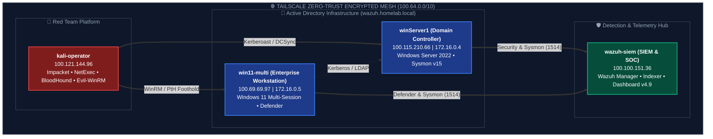
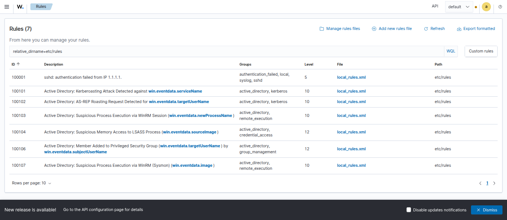
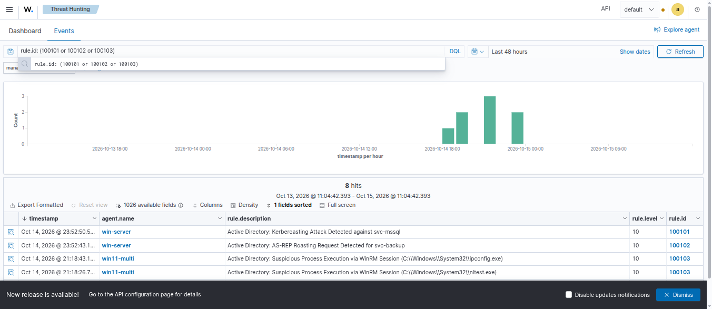
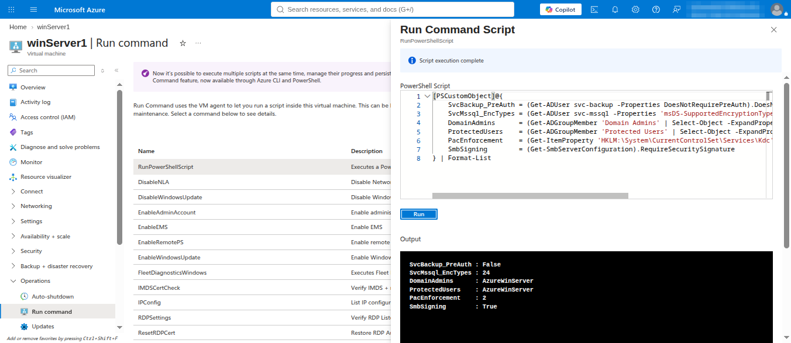
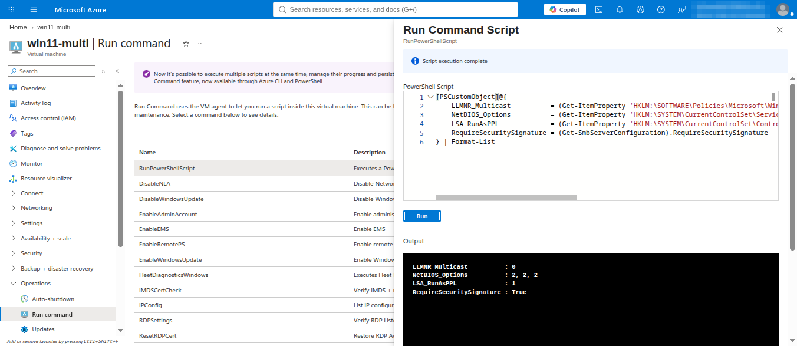

# Active Directory Purple Team & Detection Engineering Lab

[-green)](https://learn.microsoft.com/en-us/sysinternals/downloads/sysmon)

---

## 1. Lab Overview & Architecture

`azure-ad-threat-lab` is a Purple Team simulation and detection engineering laboratory designed and executed in Microsoft Azure. The lab mirrors a hybrid enterprise Active Directory environment, pairing authentic red team attack simulations with blue team forensic analysis, custom detection engineering in Wazuh SIEM, and defensive hardening.

Across **7 core attack pillars**, real-world threat actor techniques were executed from an external Kali Linux node against Windows Server 2022 and Windows 11 Enterprise Multi-Session endpoints over an encrypted Tailscale zero-trust mesh. Attacks were analyzed through raw Windows Security Event Logs, Sysmon, and Microsoft Defender telemetry, resulting in the development, testing, and deployment of custom Wazuh SIEM detection rules (`local_rules.xml`).

> [!IMPORTANT]
> ### 🔒 Infrastructure Decommissioning & Privacy Notice
> All cloud infrastructure, virtual machines, and network resources utilized throughout this project were hosted in an ephemeral, isolated lab environment and have been **permanently destroyed**.
> * **Network Addresses & Endpoints**: All IP addresses displayed throughout this documentation and embedded screenshots are obsolete, non-routable on the public internet, and permanently unassigned.
> * **Identities & Credentials**: All Active Directory identities, domain structures, Kerberos tickets, and passwords/hashes were generated solely for educational purple team simulation and have been purged.
> * **Data Sanitization**: All personal identifiers, emails, and tenant details in documentation and screenshot artifacts have been redacted and blurred. Zero live production secrets or active exposure vectors remain.

---

## 2. Infrastructure & Network Topology

The lab operates in an isolated Azure Virtual Network (`winserverlab-rg`) without any public management ports (RDP `3389` and WinRM `5985` are blocked). All inter-node communication, attack simulation, and telemetry transport traverse an encrypted **Tailscale Zero-Trust Network Access** mesh.

| Host Name | Role / Function | OS / Distribution | Tailscale IP | Internal VNet IP | Key Software / Services |
| :--- | :--- | :--- | :--- | :--- | :--- |
| **`winServer1`** | Domain Controller (DC) | Windows Server 2022 Datacenter | `100.115.210.66` | `172.16.0.4` | Active Directory Domain Services (`wazuh.homelab.local`), DNS, KDC, Wazuh Agent, Sysmon v15 |
| **`win11-multi`** | Enterprise Workstation | Windows 11 Enterprise Multi-Session | `100.69.69.97` | `172.16.0.5` | Domain-joined client (`Win11-Multi-Victim`), Wazuh Agent, Sysmon v15 |
| **`kali-operator`** | Red Team Simulation | Kali Linux 2024.x | `100.121.144.96` | VPN | Impacket suite, NetExec, BloodHound, Evil-WinRM, BloodyAD, Hashcat |
| **`wazuh-siem`** | SIEM & Telemetry Hub | Ubuntu Linux / Wazuh AIO v4.9 | `100.100.151.36` | VPN | Wazuh Indexer, Wazuh Manager, Wazuh Dashboard |

### Telemetry & Audit Pipeline Baseline:
- **Advanced Audit Policies**: Process Creation (`Event 4688` with full command-line arguments), Directory Service Access (`Event 4662`), Account Management (`Events 4728, 4732`), Kerberos Authentication & Service Tickets (`Events 4768, 4769`), Logon Events (`Events 4624, 4625`).
- **PowerShell Auditing**: ScriptBlock Logging (`Event 4104`) and Module Logging (`Event 4103`).
- **Sysmon Enrichment**: SwiftOnSecurity baseline schema capturing Process Creation (`Event 1`), Network Connections (`Event 3`), and LSASS Memory Access (`Event 10`).

---

## 3. Attack Pillars & Purple Team Matrix

Each attack was simulated, forensically audited, detected via Wazuh SIEM rules, and documented into a dedicated 5-stage Purple Team Playbook:

| Pillar | Scenario & Playbook | MITRE ATT&CK | Red Team Tools | Custom Wazuh SIEM Rule |
| :---: | :--- | :--- | :--- | :--- |
| **01** | [**Reconnaissance & Discovery**](playbooks/01-Reconnaissance-and-Discovery.md) | `T1087.002` `T1069.002` `T1018` | `netexec` `lookupsid.py` `bloodhound-python` | Baseline Audit |
| **02** | [**Kerberos & Legacy Protocols**](playbooks/02-Kerberos-Attacks-ASREPRoast-and-Kerberoast.md) | `T1558.003` `T1558.004` `T1557.001` | `impacket-GetUserSPNs` `impacket-GetNPUsers` `responder` | **`100101`** (Kerberoast) **`100102`** (AS-REPRoast) |
| **03** | [**Initial Foothold & Remote Execution**](playbooks/03-Initial-Foothold-and-Remote-Execution.md) | `T1021.006` `T1059.001` `T1082` | `evil-winrm` Living-off-the-Land (`whoami`, `nltest`) | **`100103`** (WinRM Spawning) |
| **04** | [**AD ACL Misconfiguration Abuse**](playbooks/04-AD-ACL-Misconfiguration-Abuse.md) | `T1098` `T1078.002` `T1484` | `bloodyAD` `netexec` | **`100106`** (Domain Admins Add) |
| **05** | [**Lateral Movement & Credential Dumping**](playbooks/05-Lateral-Movement-and-Credential-Dumping.md) | `T1075` `T1047` `T1003.001` `T1003.002` | `netexec smb -H` WMI execution `rundll32 comsvcs` NetExec SAM/LSA dump | **`100104`** (LSASS Read) **`100108`** (WMI Process) |
| **06** | [**Domain Dominance & Persistence**](playbooks/06-Domain-Dominance-and-Persistence.md) | `T1003.006` `T1558.001` `T1078.002` | `impacket-secretsdump` `impacket-ticketer` `netexec -k --use-kcache` | **`100105`** (DCSync Replication) |
| **07** | [**BloodHound Attack Path Remediation**](playbooks/07-BloodHound-Attack-Path-Analysis-and-Remediation.md) | `T1087` `T1069.002` `T1484` | `bloodhound-python` `bloodyAD` `netexec` | Graph Remediation & Verification |

---

## 4. Pillar Highlights & Key Technical Findings

### Pillar 1: Reconnaissance & Discovery
* **Execution**: Anonymous SMB enumeration confirmed IPC$ connectivity without credentials. RID Cycling via `lookupsid.py` scraped domain user identities (`AzureWinServer`, `asmith`, `svc-mssql`, `svc-backup`). Complete domain object relationships were extracted using `bloodhound-python`.
* **Telemetry**: Captured high-volume Network Logon (`Event 4624`, Logon Type `3`) and anonymous LDAP queries.

### Pillar 2: Kerberos Attacks & Legacy Protocol Exploitation
* **Execution**: 
  - **AS-REP Roasting**: Requested TGT for pre-auth-disabled service account `svc-backup`, returning an encrypted hash cracked via Hashcat.
  - **Kerberoasting**: Requested Service Tickets (TGS) for `svc-mssql` using RC4-HMAC (`0x17`) encryption.
  - **NetNTLMv2 Poisoning**: Deployed Responder on Kali, forced SMB authentication from `win11-multi`, and cracked the NetNTLMv2 hash.
* **Detection Engineering**: Wazuh Rules **`100101`** and **`100102`** were implemented, alerting in real-time when Event `4769` displays encryption `0x17` or Event `4768` has `PreAuthType = 0`.

### Pillar 3: Initial Foothold & Remote Execution
* **Execution**: Authenticated to `win11-multi` over WinRM port `5985` using `evil-winrm`. Executed native reconnaissance binaries (`whoami /all`, `net user /domain`, `nltest /dclist`, `ipconfig /all`).
* **The Kerberos Double-Hop Problem**: Documented why `net user /domain` fails with `System error 5` (Access is Denied) over WinRM. Type 3 network logons cannot delegate Kerberos tickets without CredSSP, Unconstrained Delegation, or direct DC authentication.
* **Detection Engineering**: Wazuh Rule **`100103`** triggered at Level 10 whenever `wsmprovhost.exe` spawned reconnaissance utilities.

### Pillar 4: Active Directory ACL Misconfiguration Abuse
* **Execution**: Seeded a misconfigured Access Control Entry (`GenericAll` over the `Domain Admins` group assigned to standard user `asmith`). Leveraged `bloodyAD` to inject `asmith` directly into `Domain Admins`. Verified full administrative compromise using NetExec: `(Pwn3d!)`.
* **Detection Engineering**: Wazuh Rule **`100106`** alerts at Level 12 whenever Event `4728` records member additions to high-privilege groups (`Domain Admins`, `Enterprise Admins`).

### Pillar 5: Lateral Movement & Credential Dumping
* **Execution**: Conducted Pass-the-Hash (PtH) against `win11-multi` using NTLM hash `b4ab7ef520e0a64a95a1b9f4d236a716` and spawned commands via WMI (`wmiprvse.exe` -> `cmd.exe`). Attempted memory dumping via `rundll32.exe comsvcs.dll MiniDump`.
* **Real-Time Endpoint Interception**: Microsoft Defender real-time protection blocked the `comsvcs.dll` dump on-host (`HackTool:Win32/DumpLsass.H`, Events `1116`/`1117`). The adversary pivoted to remote SMB SAM/LSA extraction, dumping local secrets and DCC2 cached hashes.
* **Detection Engineering**: Wazuh Rule **`100104`** detected unauthorized `lsass.exe` access via Sysmon Event `10`, while Rule **`100108`** tracked WMI child processes.

### Pillar 6: Domain Dominance & Persistence
* **Execution**: Executed a DCSync attack using `impacket-secretsdump` against `winServer1`, retrieving the master `krbtgt` credentials (`NTLM: 5a4b375aa0b5633d27b3ca126c3ae29f`, `AES256: 250578e118e7dcbcd3d684a1d647ad6e70ef58333160336af67daabcdea863ca`).
* **Modern PAC Validation Analysis**: Investigated the `KDC_ERR_TGT_REVOKED` defense triggered on Windows Server 2022 (KB5008380 / CVE-2021-42287) when forging tickets for non-existent users (`Administrator`) without PAC requestor metadata. Successfully forged a modern AES-256 PAC-compliant ticket targeting `AzureWinServer` with `-extra-pac`, achieving complete domain dominance: `(Pwn3d!)`.
* **Detection Engineering**: Wazuh Rule **`100105`** engineered to detect Event `4662` Directory Replication operations (`Get-Changes`, `Get-Changes-All`) initiated by non-machine accounts.

### Pillar 7: BloodHound Attack Path Analysis & Remediation
* **Execution & Graph Mapping**: Ingested domain object and ACL telemetry into BloodHound to map shortest attack paths from standard user `asmith` (`RID 3602`) to Tier 0 `Domain Admins`. Abused the `GenericAll` edge with `bloodyAD` to validate path viability.
* **Remediation & Defense Validation**: Surgically revoked rogue ACEs, verified AdminSDHolder protection, and re-ran BloodHound graph collection to confirm 0 reachable attack paths to Domain Admins, while NetExec confirmed privilege escalation was permanently blocked (`ERROR_DS_INSUFF_ACCESS_RIGHTS`).

---

## 5. Custom Wazuh Detection Rules

To detect techniques executed across the attack pillars, custom detection rules were engineered and deployed directly to the Wazuh Manager in [`detections/local_rules.xml`](detections/local_rules.xml). Each rule correlates Windows Security Event Logs and Sysmon telemetry against specific MITRE ATT&CK techniques:

| Rule ID | Level | Detection Scenario | Data Source | Trigger Condition | MITRE ATT&CK |
| :---: | :---: | :--- | :--- | :--- | :--- |
| **`100101`** | **10** | Kerberoasting Attack | Security `4769` | RC4-HMAC (`0x17`) requested for user SPN | `T1558.003` |
| **`100102`** | **10** | AS-REP Roasting Attack | Security `4768` | Pre-Authentication type `0` (None) | `T1558.004` |
| **`100103`** | **10** | WinRM Reconnaissance Child Process | Security `4688` | `wsmprovhost.exe` spawning LotL discovery binaries | `T1021.006` |
| **`100104`** | **12** | LSASS Memory Access / Scraping | Sysmon `10` | Suspicious granted access rights to `lsass.exe` | `T1003.001` |
| **`100105`** | **12** | DCSync Directory Replication | Security `4662` | Replication GUIDs invoked by non-DC account | `T1003.006` |
| **`100106`** | **12** | Privileged Group Membership Add | Security `4728` | Member added to `Domain Admins` / `Enterprise Admins` | `T1098` |
| **`100108`** | **10** | WMI Remote Shell Spawning | Security `4688` | `wmiprvse.exe` spawning command interpreters | `T1047` |

> [!TIP]
> The full, production-ready XML ruleset is available in [`detections/local_rules.xml`](detections/local_rules.xml). Detailed forensic walk-throughs for each rule are documented in their respective [Playbooks](playbooks/).

### Wazuh SIEM Telemetry & Detection Verification Evidence:

#### 1. Custom Active Directory Detection Rules Configuration:

*Active custom detection rules loaded in `/var/ossec/etc/rules/local_rules.xml` on Wazuh SIEM Manager (`100.100.151.36`).*

#### 2. Live Wazuh Threat Hunting Detection Stream:

*Real-time detection alerts in the Wazuh Threat Hunting console: custom rules firing for Kerberoasting (Rule `100101`, Level 10), AS-REP Roasting (Rule `100102`, Level 10), and WinRM Reconnaissance Child Processes (Rule `100103`, Level 10).*

---

## 6. Defensive Hardening Blueprint

| Attack Surface | Vulnerability / Exposure | Hardening Control & Remediation | Verification Method |
| :--- | :--- | :--- | :--- |
| **Kerberos** | Service accounts vulnerable to offline cracking (Kerberoast / AS-REPRoast) | 1. Migrate service accounts to **Group Managed Service Accounts (gMSA)**. 2. Enforce **AES-256-CTS-HMAC-SHA1-96** encryption (`msDS-SupportedEncryptionTypes = 24`). 3. Enforce Kerberos pre-authentication (`DONT_REQ_PREAUTH = False`). | `impacket-GetUserSPNs` fails to retrieve RC4 hashes; `GetNPUsers` returns `KDC_ERR_PREAUTH_REQUIRED`. |
| **Name Resolution** | Credential interception via multicast broadcast (LLMNR / NBT-NS) | 1. Disable LLMNR via GPO (`Turn off multicast name resolution = Enabled`). 2. Disable NetBIOS over TCP/IP across all network adapters. | Responder captures 0 multicast authentication requests. |
| **Remote Services** | Pass-the-Hash / NTLM Relay attacks over SMB / RPC | 1. Enforce **SMB Signing** (`RequireSecuritySignature = True`). 2. Enforce SMB Encryption (SMB 3.1.1). 3. Restrict NTLM authentication via `Network security: Restrict NTLM`. | NetExec PtH fails with `STATUS_ACCESS_DENIED` on unsigned sessions. |
| **Endpoint Memory** | LSASS memory scraping via MiniDump / Mimikatz | 1. Enable **LSA Protection** (`RunAsPPL = 1`). 2. Enable **Credential Guard** (Virtualization-Based Security). 3. Implement Microsoft Defender Attack Surface Reduction (ASR) rules. | `comsvcs.dll` and Mimikatz return `Access Denied` (`0x5`) even under local `NT AUTHORITY\SYSTEM`. |
| **Active Directory ACLs** | Unintended permission inheritance and over-permissioned ACEs | 1. Implement the **Active Directory Tiering Model** (Tier 0, Tier 1, Tier 2). 2. Audit domain ACLs regularly using BloodHound and PingCastle. 3. Enforce **AdminSDHolder** protection. | BloodHound graph analysis displays 0 unprivileged paths to `Domain Admins`. |
| **Persistence / Golden Ticket** | Domain compromise via forged TGTs | 1. Execute the **Double `krbtgt` Password Reset Procedure** (with 10-24 hour replication window). 2. Enable **PAC Requestor Enforcement** (`PacRequestorEnforcement = 2`). 3. Place Tier 0 administrative identities into the **Protected Users Security Group**. | Forged tickets fail validation immediately with `KDC_ERR_TGT_REVOKED`. |

### Hardening Implementation Evidence:

#### 1. Active Directory Hardening Verification on `winServer1` (Domain Controller):

*Real-time execution of the AD DS hardening audit via Azure Run Command on `winServer1`, confirming Kerberos pre-authentication, AES-128/256 cipher enforcement, Protected Users containment, and PAC requestor enforcement.*

#### 2. Endpoint Hardening Verification on `win11-multi` (Workstation):

*Real-time execution of the host hardening audit via Azure Run Command on `win11-multi`, confirming LLMNR disablement, NetBIOS deactivation across all interfaces, LSA Protection (RunAsPPL), and SMB signing enforcement.*

#### 3. Post-Hardening Red Team Rejection (Kali Linux):

*Post-hardening verification from Kali Linux terminal: `bloodyAD` privilege escalation is rejected by the Domain Controller with `ERROR_DS_INSUFF_ACCESS_RIGHTS` after rogue ACE revocation, and NetExec confirms `asmith` is restricted to non-administrative domain access.*

