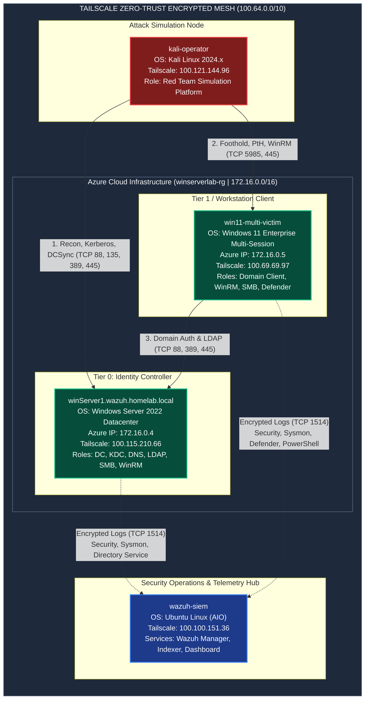
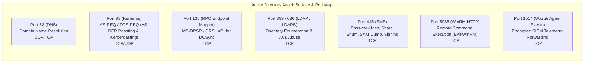
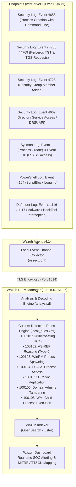

# Lab Infrastructure, Network Topology & Service Map

This document provides a comprehensive mapping of all machines, virtual networks, zero-trust mesh tunnels, active services, listening ports, forensic collectors, and detection pipelines across the **`azure-ad-threat-lab`**.

> [!NOTE]
> **Infrastructure Status**: All infrastructure nodes, internal IP subnets, and Tailscale zero-trust mesh tunnels detailed below were hosted in an ephemeral sandbox and have been **permanently decommissioned and destroyed**. All addresses are obsolete and unassigned.

---

## 1. High-Level Network & Attack Surface Topology



---

## 2. Machine & Node Inventory

| Node Name | FQDN / Hostname | Platform & OS | Internal VNet IP | Tailscale IP | Primary Role | Host Security & Agents |
| :--- | :--- | :--- | :--- | :--- | :--- | :--- |
| **`winServer1`** | `winServer1.wazuh.homelab.local` | Azure VM (Standard_B2s)<br>Windows Server 2022 Datacenter | `172.16.0.4` | `100.115.210.66` | **Tier 0 Domain Controller**<br>Active Directory Domain Services (`wazuh.homelab.local`), KDC, DNS | • Wazuh Agent v4.14<br>• Sysmon64 v15.22<br>• Advanced Audit GPOs (4688, 4662, 4768, 4769, 4728)<br>• PAC Requestor Enforcement (Mode 2) |
| **`win11-multi`** | `win11-multi-victim.wazuh.homelab.local` | Azure VM (Standard_B2ms)<br>Windows 11 Enterprise Multi-Session | `172.16.0.5` | `100.69.69.97` | **Workstation Client**<br>Domain-joined multi-session endpoint, user desktop, foothold target | • Wazuh Agent v4.14<br>• Sysmon64 v15.22 (SwiftOnSecurity)<br>• Microsoft Defender Antivirus<br>• PowerShell ScriptBlock Logging (4104)<br>• LSA Protection (RunAsPPL = 1) |
| **`kali-operator`**| `kali` | Local Hypervisor (VirtualBox)<br>Kali Linux 2024.x Rolling | `10.0.2.15` (NAT) | `100.121.144.96` | **Adversary Simulation Node**<br>Attack platform executing all 7 Attack Pillars via Impacket, NetExec, BloodHound, Evil-WinRM | • OpenSSH Server (port 22)<br>• Tailscale Client (VPN mesh routing)<br>• Python 3.11 / Impacket / NetExec |
| **`wazuh-siem`** | `wazuh-server` | Linux VM / Container Host<br>Ubuntu 22.04 LTS | `192.168.x.x` | `100.100.151.36` | **SIEM & Security Analytics**<br>All-in-One Wazuh Indexer, Analysis Manager & Web Dashboard | • Wazuh Manager 4.9<br>• Wazuh Indexer (OpenSearch)<br>• Custom Rules (`local_rules.xml` 100101-100108)<br>• Wazuh Dashboard HTTPS Web UI |

---

## 3. Comprehensive Services, Ports & Protocols Matrix



### Detailed Service Specification Table:

| Host | Service / Daemon | Process Name | Port(s) | Protocol | Function in the Lab | Security / Hardening Posture |
| :--- | :--- | :--- | :--- | :--- | :--- | :--- |
| **`winServer1`** | Kerberos Key Distribution Center | `lsass.exe` | **`88`** | TCP/UDP | Authenticates domain accounts, issues TGTs and service tickets (TGS). | • **Hardened**: AES-128/256 enforced on `svc-mssql`<br>• Pre-Auth enforced on `svc-backup`<br>• PAC Requestor Enforcement = 2 |
| **`winServer1`** | Active Directory LDAP | `ntds.dit` / `lsass.exe` | **`389`**, **`636`** | TCP | Object querying, schema management, ACL resolution. | • Audited via Event 4662<br>• Over-permissioned `asmith` ACE revoked |
| **`winServer1`** | MS-RPC Endpoint Mapper | `rpcss.dll` / `svchost.exe` | **`135`** | TCP | Dynamic RPC port resolution for replication (DRSUAPI). | • Event 4662 detection (Rule `100105`) triggers on non-DC replication queries |
| **`winServer1`** | Server Message Block (SMB) | `System` (`srv2.sys`) | **`445`** | TCP | File shares (`SYSVOL`, `NETLOGON`, IPC$), Named Pipes. | • **SMB Signing Enforced** (`RequireSecuritySignature = True`)<br>• SMBv1 Disabled |
| **`winServer1`** | Windows Remote Management | `wsmprovhost.exe` | **`5985`** | TCP | Administrative remote PowerShell execution. | • Public NSG blocked; accessible only via Tailscale mesh |
| **`winServer1`** | Wazuh Log Shipper Agent | `wazuh-agent.exe` | Dynamic | TCP | Forwards Windows Event Logs (Security, Sysmon) to Manager. | • Monitored continuously by Wazuh Watchdog |
| **`win11-multi`** | Windows Remote Management | `wsmprovhost.exe` | **`5985`** | TCP | Initial foothold access point via `evil-winrm`. | • Wazuh Rule `100103` monitors suspicious child processes (`whoami`, `nltest`) |
| **`win11-multi`** | Server Message Block (SMB) | `System` (`srv2.sys`) | **`445`** | TCP | Administrative shares (`C$`, `ADMIN$`), SAM database access. | • **SMB Signing Enforced**<br>• Local admin `azureuser` isolated |
| **`win11-multi`** | Local Security Authority (LSA) | `lsass.exe` | Local | Memory | Stores logon sessions, Kerberos tickets, NTLM hashes. | • **Hardened**: LSA Protection (`RunAsPPL = 1`)<br>• Sysmon Event 10 Detection (Rule `100104`) |
| **`win11-multi`** | Name Resolution (LLMNR / NetBT)| `svchost.exe` (`dnscache`) | **`5355`**, **`137`** | UDP | Legacy multicast broadcast name queries. | • **Hardened**: LLMNR disabled (`EnableMulticast = 0`); NetBIOS disabled (`NetbiosOptions = 2`) |
| **`win11-multi`** | Windows Defender Real-Time | `MsMpEng.exe` | Local | Service | On-host antivirus and behavior monitoring. | • Active: intercepted in-flight LSASS dump (`HackTool:Win32/DumpLsass.H`, Events 1116/1117) |
| **`kali-operator`**| Impacket / NetExec Suite | Python 3 | Dynamic | TCP | Executes red team attack simulations across Tailscale mesh. | • Originator of all simulated attack traffic |
| **`wazuh-siem`** | Wazuh Analysis Manager | `wazuh-analysisd` | **`1514`** | TCP | Ingests agent logs, correlates events against `local_rules.xml`. | • Custom rules `100101` - `100108` running |
| **`wazuh-siem`** | Wazuh Indexer (OpenSearch) | `java` | **`9200`** | TCP | Indexes all normalized alert and event JSON documents. | • Scalable full-text search backend |
| **`wazuh-siem`** | Wazuh Dashboard Web UI | `node` | **`443`** | HTTPS | Analyst console for alert discovery, MITRE dashboards, search. | • Authenticated web access on `https://100.100.151.36` |

---

## 4. Identity & Domain Architecture (`wazuh.homelab.local`)

```text
Domain: wazuh.homelab.local
Domain SID: S-1-5-21-3332230180-1108682337-2359799131

[Active Directory Structure]
OU=LabResources,DC=wazuh,DC=homelab,DC=local
├── OU=Admins
│   └── User: AzureWinServer (RID 500 | Domain Admin | Tier 0 | Protected Users Member)
├── OU=StandardUsers
│   └── User: asmith (RID 3602 | Standard User | Previously abused GenericAll ACL)
├── OU=ServiceAccounts
│   ├── User: svc-backup (RID 3603 | Pre-Auth Enforced | Remediated from AS-REP Roast)
│   └── User: svc-mssql  (RID 3604 | SPN: MSSQLSvc/winServer1... | AES-128/256 Enforced)
└── OU=Computers
    ├── Computer: WINSERVER1$ (Domain Controller | Windows Server 2022)
    └── Computer: WIN11-MULTI-VICTIM$ (Workstation Client | Windows 11 Enterprise)
```

---

## 5. Telemetry & Detection Pipeline Architecture


