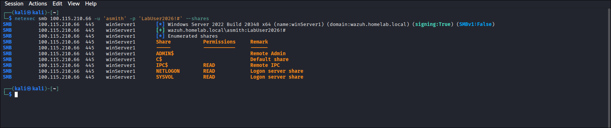
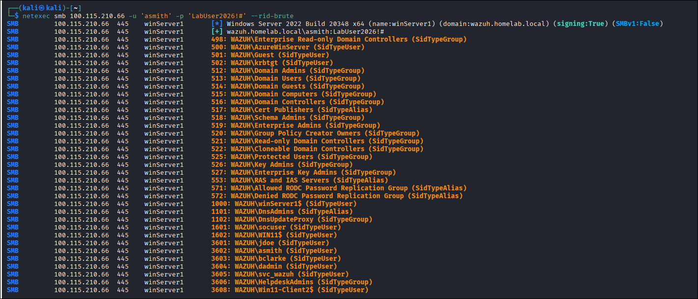
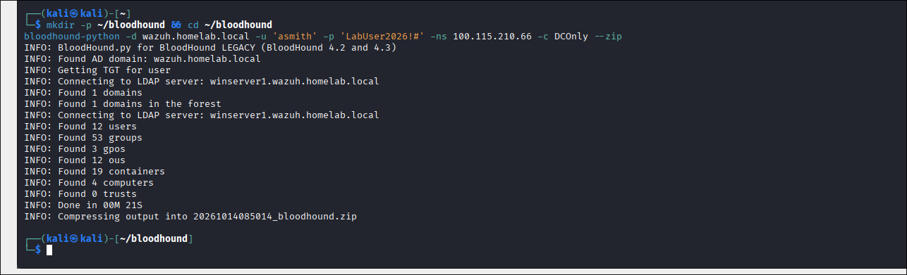
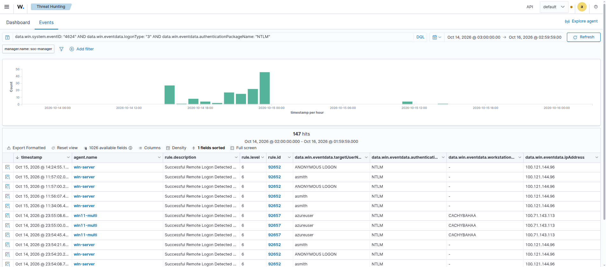

# Pillar 1: Active Directory Reconnaissance & Discovery

A complete purple team playbook covering Active Directory enumeration from an unprivileged perspective across the Zero-Trust Tailscale mesh, capturing forensic Windows telemetry, evaluating Wazuh SIEM detection logic, and establishing defensive hardening controls.

---

## 1. Technique & MITRE ATT&CK Overview

* **Primary Tactic**: Discovery (`TA0007`)
* **Technique IDs**: **T1087.002** (Domain Account Discovery), **T1069.002** (Domain Groups Discovery), **T1135** (Network Share Discovery)
* **Adversary Objective**: Map domain topology, harvest valid user accounts and security groups, enumerate readable SMB network shares, and identify high-value targets (Domain Admins) from an unprivileged position without triggering alert thresholds.

---

## 2. Red Team Attack Procedures

### Procedure 1.1: Anonymous / Null Session Share Check
Adversaries probe SMB to determine if the target allows anonymous browsing or null sessions to enumerate shares without valid domain credentials.

```bash
# Executed on Kali Linux:
netexec smb 100.115.210.66 -u '' -p '' --shares
```

*Result:* Target enforces authentication and rejects anonymous share listing (`STATUS_ACCESS_DENIED`).

---

### Procedure 1.2: Authenticated SMB Share Enumeration
Using a low-privilege domain account (`asmith` / `LabUser2026!#`), the attacker enumerates accessible shares:

```bash
# Executed on Kali Linux:
netexec smb 100.115.210.66 -u 'asmith' -p 'LabUser2026!#' --shares
```



*Result:* Valid domain credentials grant READ access to `IPC$`, `NETLOGON`, and `SYSVOL`, confirming active domain participation. Administrative shares (`C$`, `ADMIN$`) remain restricted.

---

### Procedure 1.3: RID Cycling User Enumeration (SAMR Brute-force)
RID cycling queries the Security Account Manager Remote (SAMR) RPC interface over `IPC$` (`\pipe\samr`), cycling through relative IDs (500–1000+) to enumerate usernames and groups even if LDAP queries are restricted.

```bash
# Executed on Kali Linux:
netexec smb 100.115.210.66 -u 'asmith' -p 'LabUser2026!#' --rid-brute
```



*Result:* Successfully enumerated 10 domain objects including built-in Administrator (`RID 500`), Domain Admins (`RID 512`), standard users (`asmith`, `jdoe`, `bclarke`), and service accounts (`svc_wazuh`).

---

### Procedure 1.4: BloodHound Domain Object Graph Ingestion
BloodHound queries LDAP (`389`) and Global Catalog (`3268`) on the DC to map object relationships, ACL permissions, and attack paths.

```bash
# Executed on Kali Linux:

bloodhound-python -d wazuh.homelab.local -u 'asmith' -p 'LabUser2026!#' -ns 100.115.210.66 -c DCOnly --zip
```



*Result:* Harvested the complete Active Directory directory schema (10 users, 53 groups, 3 GPOs, 4 computers) into a structured JSON archive ready for graph analysis.

---

## 3. Blue Team Forensic Telemetry

### Monitored Event IDs

| Channel | Event ID | Description | Key Extraction Fields |
| :--- | :--- | :--- | :--- |
| `Security` | **4624** | Successful Network Logon | `TargetUserName: asmith`, `LogonType: 3`, `IpAddress: 100.121.144.96`, `LogonProcessName: NtLmSsp` |
| `Security` | **4776** | Credential Validation | `TargetUserName: asmith`, `Workstation: kali`, `Status: 0x0` |
| `Security` | **4627** | Group Membership Evaluation | `TargetUserName: asmith`, `GroupMembership: Domain Users` |
| `Security` | **4634** | Account Logoff | `TargetUserName: asmith`, `LogonType: 3` |
| `Sysmon` | **Event 3** | Network Connection | `Image: System`, `DestinationPort: 445 / 389`, `SourceIp: 100.121.144.96` |


## 4. Detection Strategy & Threat Hunting (Wazuh SIEM)

### The Detection Challenge: Why Baseline Auditing Over Static Rules?
Unprivileged reconnaissance (SMB share probing, SAMR RID cycling, and BloodHound LDAP enumeration) abuses legitimate Windows administrative protocols. 

In a production enterprise SOC, creating a static alert rule on individual Network Logons (`Event 4624`, Logon Type 3) generates overwhelming false-positive noise. Therefore, initial Active Directory discovery is monitored through **baseline security auditing** and proactive **threat hunting**, rather than rigid alert thresholds.

---

### Proactive Threat Hunting in Wazuh Dashboard

SOC analysts hunt for reconnaissance patterns in Wazuh (`Discover`) by isolating unusual authentication behaviors:

#### 1. Inbound NTLM Authentication from Non-Domain / Untrusted Nodes
Adversary tools (NetExec, Impacket) generate network logons using NTLM over SMB. Hunt for incoming authentications originating outside standard corporate IP ranges:
```text
data.win.system.eventID: "4624" AND data.win.eventdata.logonType: "3" AND data.win.eventdata.authenticationPackageName: "NTLM"
```


*Wazuh Threat Hunting console isolating inbound NTLM network logons (`Event 4624`, Logon Type 3) originating from Kali Linux (`100.121.144.96`) targeting `win-server`. Telemetry highlights unprivileged `ANONYMOUS LOGON` reconnaissance and user enumeration attempts (`asmith`).*

#### 2. Anomalous Workstation Identification
RID cycling and BloodHound typically report the attacker machine's local hostname in the validation handshake (`Event 4776`). Hunt for domain validations from unexpected workstation names:
```text
data.win.system.eventID: "4776" AND NOT data.win.eventdata.workstation: ("WINSERVER1" OR "WIN11-MULTI" OR "-")
```
*Indicator:* The lab captured `Workstation: kali` and IP `100.121.144.96` attempting rapid sequential authentications.

#### 3. Rapid Logon Volumetrics (RID Cycling Indicator)
RID brute-forcing queries hundreds of RIDs in seconds, producing a sudden burst of `4624` (Logon) $\rightarrow$ `4627` (Group Evaluation) $\rightarrow$ `4634` (Logoff) cycles. Analysts group log streams by `data.win.eventdata.ipAddress` to identify frequency spikes over short 60-second timeframes.

---

## 5. Defensive Hardening & Prevention

1. **Restrict Anonymous SAM Enumeration**:
   Configure via GPO:
   - *Computer Configuration -> Windows Settings -> Security Settings -> Local Policies -> Security Options*
   - Set `Network access: Do not allow anonymous enumeration of SAM accounts and shares` to **Enabled**.
   - Set `Network access: Restrict clients allowed to make remote calls to SAM` to restrict SAMR queries only to Administrators:
     ```text
     O:SYG:SYD:(A;;RC;;;BA)
     ```
2. **Disable NTLM in favor of Kerberos**:
   Configure GPO: *Network security: Restrict NTLM: Audit NTLM authentication in this domain* -> Evaluate and transition toward *Deny all*.
3. **Threshold-Based LDAP Auditing & Canary Decoys (Detecting BloodHound Safely)**:
   - **Threshold Registry Tuning**: Raw diagnostic logging (`Field Engineering = 5`) generates excessive event volume and risks disk exhaustion on production Domain Controllers. Instead, configure **threshold-based logging** under `HKLM\SYSTEM\CurrentControlSet\Services\NTDS\Parameters`:
     - Set `Expensive Search Results Threshold` to `10000` and `Inefficient Search Results Threshold` to `1000`. This suppresses normal directory traffic (e.g., Outlook lookups) and exclusively records **Event 1644** when automated tools request massive object sets.
   - **Active Directory Canary Objects**: Deploy decoy high-value accounts (e.g., `svc-backup-admin`) with an attached audit SACL (**Event 4662**). Because BloodHound systematically scrapes every domain object to map graph edges, it inevitably queries the decoy, triggering an immediate high-fidelity alert with zero operational disk overhead.
