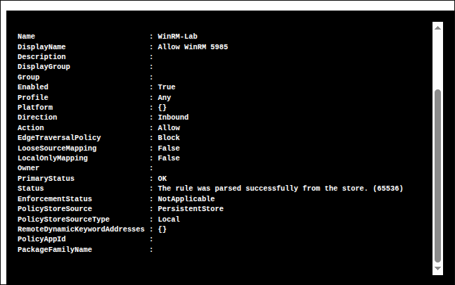
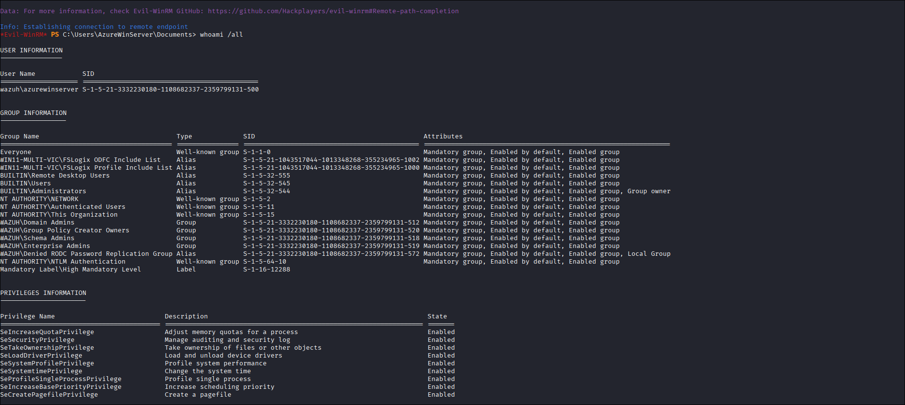
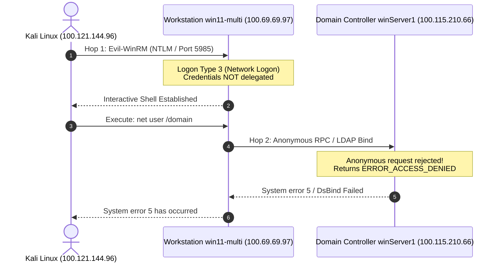
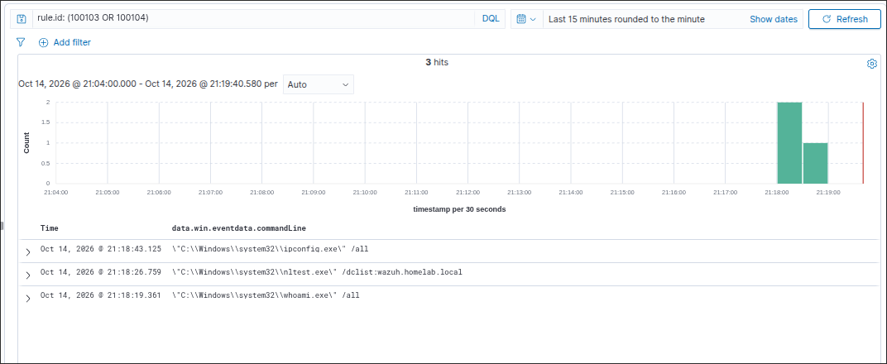

# Pillar 3: Initial Foothold & Remote Execution (WinRM Lateral Movement, The Double-Hop Problem & LotL Discovery)

An end-to-end Purple Team investigation into initial foothold acquisition, remote shell execution over Windows Remote Management (WinRM), the mechanics of the Kerberos Double-Hop Problem, forensic telemetry across Windows Security and Sysmon channels, and SIEM detection engineering using custom Wazuh rules.

---

## 1. Technique & MITRE ATT&CK Overview

* **Primary Tactics**: Lateral Movement (`TA0008`), Execution (`TA0002`), Discovery (`TA0007`)
* **Technique IDs**: **T1021.006** (Windows Remote Management), **T1059.001** (PowerShell), **T1087** (Account Discovery), **T1016** (Network Discovery)
* **Adversary Objective**: Gain an interactive remote shell on domain endpoint `win11-multi` over WinRM (`TCP 5985`), execute Living-off-the-Land (LotL) situational awareness commands, analyze the Kerberos Double-Hop restriction, and evaluate Sysmon/Wazuh process creation detections.

---

## 2. Red Team Attack Procedures

### Lab Setup & Host Preparation
To simulate a workstation configured for remote administrative management, WinRM was enabled on `win11-multi` with an inbound firewall rule allowing traffic on TCP port `5985`:

```powershell
# Executed on win11-multi:
Enable-PSRemoting -Force -SkipNetworkProfileCheck
New-NetFirewallRule -Name "WinRM-Lab" -DisplayName "Allow WinRM 5985" -Enabled True -Direction Inbound -Protocol TCP -LocalPort 5985 -Action Allow
```



---

### Procedure 3.1: Remote Foothold via Evil-WinRM
Using valid credentials obtained during reconnaissance, an interactive PowerShell session was established from Kali Linux targeting the victim workstation over the Tailscale network:

```bash
# Executed from Kali Linux:
evil-winrm -i 100.69.69.97 -u AzureWinServer -p 'AzureLab2026!#'
```

---

### Procedure 3.2: Living-off-the-Land (LotL) Reconnaissance
Once connected, the adversary initiated host reconnaissance using native Windows utilities:

```powershell
whoami /all
```



#### Privileges & Group Analysis:
* **SID**: `S-1-5-21-3332230180-1108682337-2359799131-500` (RID 500 Domain Administrator).
* **High-Privilege Groups**: `BUILTIN\Administrators`, `WAZUH\Domain Admins`, `WAZUH\Enterprise Admins`, `WAZUH\Schema Admins`.
* **Integrity Level**: `Mandatory Label\High Mandatory Level`.
* **Enabled Token Privileges**: `SeSecurityPrivilege`, `SeTakeOwnershipPrivilege`, `SeLoadDriverPrivilege`, `SeSystemProfilePrivilege`, `SeIncreaseBasePriorityPrivilege`.

---

### Procedure 3.3: Encountering the Kerberos Double-Hop Problem
When attempting to enumerate domain-wide Active Directory objects from the workstation shell, the commands failed despite having full Domain Admin credentials:

```powershell
*Evil-WinRM* PS C:\Users\AzureWinServer\Documents> net user /domain
The request will be processed at a domain controller for domain wazuh.homelab.local.
net.exe : System error 5 has occurred.

*Evil-WinRM* PS C:\Users\AzureWinServer\Documents> net group "Domain Admins" /domain
The request will be processed at a domain controller for domain wazuh.homelab.local.
net.exe : System error 5 has occurred.

*Evil-WinRM* PS C:\Users\AzureWinServer\Documents> nltest /dclist:wazuh.homelab.local
Get list of DCs in domain 'wazuh.homelab.local' from '\\winServer1.wazuh.homelab.local'.
nltest.exe : You don't have access to DsBind to wazuh.homelab.local (\\winServer1.wazuh.homelab.local) (Trying NetServerEnum).
```



#### Technical Root Cause:
1. **Network Logon Boundary**: Connecting to `win11-multi` over WinRM creates a **Logon Type 3 (Network)** session.
2. **Credential Delegation Restrictions**: Windows security architecture prohibits an unconstrained remote session from delegating the user's authentication credentials to a second remote machine (Hop 2: `win11-multi` $\rightarrow$ `winServer1`).
3. **Anonymous Fallback**: When `net.exe` or `nltest.exe` queries the Domain Controller across the network, `win11-multi` has no delegated Kerberos TGT or plaintext password to present on the user's behalf. The request arrives at `winServer1` as unauthenticated/anonymous, which the Domain Controller immediately rejects with **`System error 5` (Access Denied)**.
4. **Local Execution Remains Fully Functional**: Commands executed against `win11-multi` locally (`whoami`, `ipconfig`, `net localgroup Administrators`, SAM/LSASS access) operate with full elevated privileges because no network delegation is required.

#### Offensive Pivot Strategy (Overcoming the Hop):
Because the Double-Hop boundary strictly prevents Hop 2 network queries back to the Domain Controller, an adversary cannot directly manage or enumerate Active Directory from this remote shell. To progress the attack lifecycle, the adversary must pivot:
1. **Local Credential Harvesting (Pillar 5)**: Dump cached credentials, LSA secrets, and SAM hashes residing locally in memory on `win11-multi` (where elevated execution is fully functional).
2. **Direct Authentication from Attack Host (Pillar 4)**: Return to Kali Linux and authenticate directly against the Domain Controller using newly discovered credentials or ACL misconfigurations, bypassing the intermediate hop entirely.

---

## 3. Blue Team Forensic Telemetry

### Forensic Log Telemetry (Captured Live on `win11-multi`)

#### 1. Inbound Network Authentication (Event ID 4624)
> **Key Detection Indicator:** A privileged domain account (`AzureWinServer`) established a `LogonType: 3` (Network Logon) using `AuthenticationPackageName: NTLM` over port `5985` originating from an external, non-domain workstation (`KALI` / `100.121.144.96`) with `ElevatedToken: Yes`.

```yaml
EventID: 4624
Channel: Security
Task: Logon
LogonType: 3 # Network Logon (Remote connection via WinRM)
TargetUserName: AzureWinServer
TargetDomainName: WAZUH
AuthenticationPackageName: NTLM
LmPackageName: NTLM V2
WorkstationName: KALI
IpAddress: 100.121.144.96
IpPort: 51240
ElevatedToken: Yes
```

#### 2. WinRM Provider Host Initialization (Event ID 4688)
> **Key Detection Indicator:** Spawning of `wsmprovhost.exe` with command-line parameter `-Embedding` by parent `svchost.exe` (WinRM Service). This confirms the initialization of a remote PowerShell management worker process running under high mandatory integrity (`S-1-16-12288`).

```yaml
EventID: 4688
Channel: Security
CreatorSubject:
  AccountName: win11-multi$
  DomainName: WAZUH
NewProcessName: C:\Windows\System32\wsmprovhost.exe
ProcessCommandLine: C:\Windows\system32\wsmprovhost.exe -Embedding
CreatorProcessName: C:\Windows\System32\svchost.exe # WinRM Service Host
MandatoryLabel: S-1-16-12288 (High Mandatory Level)
```

#### 3. LotL Child Process Spawning (Sysmon Event ID 1 & Security Event ID 4688)
> **Key Detection Indicator:** `wsmprovhost.exe` spawning interactive Living-off-the-Land (LotL) discovery binaries (`whoami.exe`, `nltest.exe`, `ipconfig.exe`). Legitimate automated orchestration (Ansible, SCCM) rarely invokes interactive discovery tools; their execution under WinRM indicates an interactive attacker session.

```yaml
EventID: 4688 / Sysmon 1
Channel: Security / Microsoft-Windows-Sysmon/Operational
ParentProcessName: C:\Windows\System32\wsmprovhost.exe
NewProcessName: C:\Windows\System32\whoami.exe
CommandLine: '"C:\Windows\system32\whoami.exe" /all'
User: WAZUH\AzureWinServer
IntegrityLevel: High
```

```yaml
EventID: 4688 / Sysmon 1
ParentProcessName: C:\Windows\System32\wsmprovhost.exe
NewProcessName: C:\Windows\System32\nltest.exe
CommandLine: '"C:\Windows\system32\nltest.exe" /dclist:wazuh.homelab.local'
User: WAZUH\AzureWinServer
```

---

## 4. Detection Engineering (Wazuh SIEM)

### Baseline Detection Audit & Telemetry Gap Analysis
Live inspection of the default Wazuh ruleset identified critical detection gaps:
* **Level 3 Suppression**: Default Wazuh captures `wsmprovhost.exe` and child processes under generic **Rule `67027` (Level 3 - A process was created)**. In enterprise environments, Level 3 alerts are discarded or buried in benign noise.
* **`nltest.exe` Blindspot**: While `net.exe` triggered a generic discovery rule (`Rule 92039`), `nltest.exe` generated **0 security alerts**.
* **Missing ATT&CK Context**: No default correlation rule flags interactive remote management sessions executing reconnaissance binaries (T1021.006).

### Custom Detection Rule (`local_rules.xml`)
To bridge this gap, a high-fidelity detection rule was engineered and deployed to `/var/ossec/etc/rules/local_rules.xml` on the Wazuh Manager (`100.100.151.36`):

```xml
<group name="active_directory,detection_engineering,">

  <!-- ============================================================ -->
  <!-- Rule 100103: Suspicious Process Execution via WinRM (4688)   -->
  <!-- MITRE ATT&CK: T1021.006 (WinRM) / T1059 (Command & Scripting)-->
  <!-- ============================================================ -->
  <rule id="100103" level="10">
    <if_sid>60103</if_sid>
    <field name="win.system.eventID">^4688$</field>
    <field name="win.eventdata.parentProcessName" type="pcre2">(?i)wsmprovhost\.exe$</field>
    <field name="win.eventdata.newProcessName" type="pcre2">(?i)(whoami|net|net1|nltest|cmd|powershell|pwsh|ipconfig|systeminfo|quser|qwinsta|tasklist|reg|certutil)\.exe$</field>
    <description>Active Directory: Suspicious Process Execution via WinRM Provider Host ($(win.eventdata.newProcessName))</description>
    <mitre>
      <id>T1021.006</id>
      <id>T1059.001</id>
      <id>T1087</id>
    </mitre>
  </rule>

</group>
```

### Threat Hunting & Correlation Query (Sysmon Event ID 1)
For environments prioritizing Sysmon process telemetry over native Windows auditing, the same adversary behavior is hunted using the following OpenSearch / Wazuh Discover query:
```text
data.win.eventdata.parentImage: *wsmprovhost.exe AND data.win.eventdata.image: (*whoami.exe OR *net.exe OR *nltest.exe OR *ipconfig.exe OR *cmd.exe OR *powershell.exe)
```

---

### Detection Validation & Alert Evidence
Executing `whoami /all`, `nltest /dclist:wazuh.homelab.local`, and `ipconfig /all` inside the Evil-WinRM shell instantly triggered **Rule `100103`** across all three processes at **Level 10**:



---

## 5. Hardening & Prevention

### 1. Disable WinRM on Tier 2 Endpoints (Workstations)
Standard enterprise user workstations have no legitimate business requirement to expose WinRM listeners. WinRM should be restricted exclusively to dedicated management jumpboxes and servers:
```powershell
# GPO Computer Configuration -> Policies -> Administrative Templates -> Windows Components -> Windows Remote Management (WinRM) -> WinRM Service:
# Disable "Allow remote server management through WinRM"
Disable-PSRemoting -Force
Stop-Service -Name WinRM
Set-Service -Name WinRM -StartupType Disabled
```

### 2. Windows Firewall Scope Restriction
If WinRM is mandated for automated endpoint orchestration, restrict port `5985` and `5986` strictly to authorized administrative management subnets:
```powershell
Set-NetFirewallRule -Name "WINRM-HTTP-In-TCP" -RemoteAddress "100.100.151.36/32" # Example: SIEM / Orchestrator only
```

### 3. Mitigate the Double-Hop Vulnerability & Block NTLM Network Logons
* **Protected Users Security Group**: Add privileged domain administrator accounts to the **Protected Users** group in Active Directory. This prevents NTLM authentication, blocks credential caching in LSASS, and disables unconstrained delegation.
* **Enforce Kerberos with JEA (Just Enough Administration)**: Replace interactive shells with role-tailored non-administrative JEA endpoints running in Constrained Language Mode.

### 4. Enable PowerShell Script Block Logging (Event ID 4104) & Constrained Language Mode (CLM)
Because WinRM natively executes commands through the PowerShell engine, enabling runtime script block auditing captures malicious commands even if adversaries use encoded commands or obfuscation:
* **Enable Script Block Logging via GPO**:
  * **Path**: `Computer Configuration > Administrative Templates > Windows Components > Windows PowerShell`
  * **Policy**: **Turn on PowerShell Script Block Logging** -> **Enabled**
  * Logs all script blocks executed in memory to `Microsoft-Windows-PowerShell/Operational` under **Event ID 4104**.
* **Enforce Constrained Language Mode (CLM)**:
  Configure AppLocker or Windows Defender Application Control (WDAC) to force PowerShell sessions into Constrained Language Mode (`$ExecutionContext.SessionState.LanguageMode = "ConstrainedLanguage"`). This strips access to arbitrary .NET APIs, COM objects, and unapproved script execution in remote WinRM sessions.
