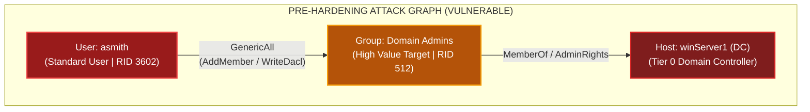
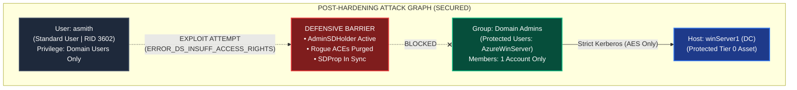
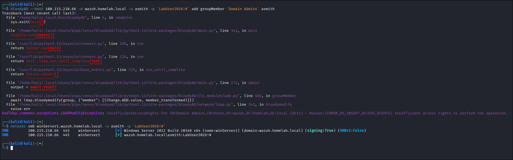

# Active Directory Attack Path Remediation: BloodHound Graph Analysis (Before vs. After)

A comprehensive study demonstrating **Attack Path Management (APM)** in Active Directory. This study examines how graph theory exposes hidden privilege escalation paths, analyzes the red-team abuse of discretionary access control lists (DACLs), documents blue-team detection engineering, and proves how surgical hardening eliminates adversary paths to Tier 0 assets.

---

## 1. Overview & The Graph Problem

In enterprise Active Directory environments, misconfigured Access Control Entries (ACEs) frequently create unintended, transitive privilege escalation paths. An adversary who compromises a seemingly benign standard user account can traverse these identity graph relationships to attain full Domain Admin dominance without ever needing to crack passwords or trigger noisy exploits.

```
+---------------------------------------------------------------------------------------------------------+
|                                    THE ATTACK PATH LIFECYCLE                                            |
+---------------------------------------------------------------------------------------------------------+
|                                                                                                         |
|  [Standard User: asmith]                                                                                |
|          |                                                                                              |
|          | (GenericAll ACE: Full control over Domain Admins group object)                               |
|          v                                                                                              |
|  [Security Group: Domain Admins]                                                                        |
|          |                                                                                              |
|          | (MemberOf: Administrative control over Domain Controllers)                                   |
|          v                                                                                              |
|  [Domain Controller: winServer1]  ======>  TOTAL DOMAIN COMPROMISE (DCSync, Golden Ticket)              |
|                                                                                                         |
+---------------------------------------------------------------------------------------------------------+
```

Through the combined deployment of **BloodHound**, **BloodyAD**, **Wazuh SIEM**, and **Active Directory Hardening Controls**, this lab simulates the complete lifecycle of finding, exploiting, detecting, and eliminating this critical vulnerability.

---

## 2. Pre-Hardening State: The Vulnerable Attack Path

### 2.1 Graph Mapping via BloodHound
During **Pillar 1 (Reconnaissance & Discovery)**, the adversary ran `bloodhound-python` from Kali Linux across the Tailscale mesh:

```bash
bloodhound-python -d wazuh.homelab.local -u 'asmith' -p 'LabUser2026!#' -ns 100.115.210.66 -c All --zip
```

BloodHound ingested all Active Directory objects and access control lists, revealing a direct edge between the standard user `asmith` and the high-value target `Domain Admins`:



### 2.2 Exploitation via BloodyAD (Pillar 4)
Because `asmith` held `GenericAll` over `Domain Admins`, the account possessed discretionary permission to inject arbitrary members into the group:

```bash
# Red Team Execution from Kali Linux (100.121.144.96):
bloodyAD --host 100.115.210.66 -d wazuh.homelab.local -u asmith -p 'LabUser2026!#' add groupMember 'Domain Admins' asmith
```

### 2.3 Verification of Domain Compromise
NetExec instantly verified that `asmith` was promoted to a full Domain Administrator:

```bash
netexec smb winServer1.wazuh.homelab.local -u asmith -p 'LabUser2026!#'
```
```text
SMB    100.115.210.66  445  winServer1  [*] Windows Server 2022 (name:winServer1) (signing:True)
SMB    100.115.210.66  445  winServer1  [+] wazuh.homelab.local\asmith:LabUser2026!# (Pwn3d!)
```

---

## 3. Defensive Hardening & Remediation Protocol

To eliminate this attack path permanently, a 4-step hardening procedure was engineered:

### Step 1: Privilege Containment (Pruning Group Membership)
The unauthorized account was stripped from the `Domain Admins` group:
```powershell
Remove-ADGroupMember -Identity "Domain Admins" -Members asmith -Confirm:$false
```

### Step 2: DACL Remediation (Revoking Rogue ACEs)
All explicit and inherited permissions granted to `asmith` on the `Domain Admins` object were purged:
```powershell
Import-Module ActiveDirectory
$target = Get-ADGroup "Domain Admins"
$dn = $target.DistinguishedName
$acl = Get-Acl "AD:$dn"
$toRemove = $acl.Access | Where-Object { $_.IdentityReference -like "*asmith*" }
foreach ($r in $toRemove) {
    $acl.RemoveAccessRule($r) | Out-Null
}
$admin = New-Object System.Security.Principal.NTAccount("wazuh.homelab.local\AzureWinServer")
$acl.SetOwner($admin)
Set-Acl -Path "AD:$dn" -AclObject $acl
```

### Step 3: AdminSDHolder & SDProp Enforcement
Protected groups (`Domain Admins`, `Enterprise Admins`, `Administrators`) were verified against the **AdminSDHolder** container template (`CN=AdminSDHolder,CN=System,DC=wazuh,DC=homelab,DC=local`) to ensure inheritance blocking and automated permission correction.

### Step 4: Tier 0 Identity Isolation (Protected Users Group)
The legitimate built-in administrator account (`AzureWinServer`) was added to the **Protected Users** security group:
```powershell
Add-ADGroupMember -Identity "Protected Users" -Members AzureWinServer
```
* **Security Impact**: Prohibits NTLM authentication, prevents Kerberos ticket caching in LSASS on compromised workstations, and mandates AES encryption.

---

## 4. Post-Hardening State: Severed Graph & Exploit Rejection

### 4.1 Post-Hardening Graph Topology
Following remediation, BloodHound was re-executed from Kali Linux, generating the post-hardening verification archive (`20261015043239_bloodhound.zip`). Ingesting and parsing the resulting graph telemetry confirms:
* **Inbound ACEs on `Domain Admins` from `asmith`**: `0` (Cleaned)
* **Reachable Shortest Paths to `Domain Admins` from standard users**: `0` (Severed)



### 4.2 Verifying Exploit Rejection (Live Proof)
When the adversary attempts to re-execute the identical `bloodyAD` exploit from Kali Linux:

```bash
# Executed on Kali Linux post-hardening:
bloodyAD --host 100.115.210.66 -d wazuh.homelab.local -u asmith -p 'LabUser2026!#' add groupMember 'Domain Admins' asmith
```

#### Verbatim Execution Error:
```text
badldap.commons.exceptions.LDAPModifyException: insufficientAccessRights for CN=Domain Admins,CN=Users,DC=wazuh,DC=homelab,DC=local (Attr)
— Reason: (ERROR_DS_INSUFF_ACCESS_RIGHTS) Insufficient access rights to perform the operation.
```

### 4.3 Verifying Privilege De-escalation
Checking the account status via NetExec confirms that `asmith` is strictly a standard domain user:

```bash
netexec smb winServer1.wazuh.homelab.local -u asmith -p 'LabUser2026!#'
```
```text
SMB    100.115.210.66  445  winServer1  [*] Windows Server 2022 (name:winServer1) (signing:True)
SMB    100.115.210.66  445  winServer1  [+] wazuh.homelab.local\asmith:LabUser2026!#
```
*(Notice: The `(Pwn3d!)` administrative compromise flag is gone).*


*Kali terminal capture confirming that bloodyAD privilege escalation fails with `ERROR_DS_INSUFF_ACCESS_RIGHTS` and NetExec confirms unprivileged standard user authentication.*

---

## 5. Comparative Attack Surface Matrix

| Security Metric | Pre-Hardening Baseline | Post-Hardening State | Defensive Impact |
| :--- | :--- | :--- | :--- |
| **`asmith` Group Membership** | `Domain Admins`, `Domain Users` | `Domain Users` (Only) | Escalated privileges eliminated. |
| **`Domain Admins` Object Owner** | `asmith` | `wazuh.homelab.local\AzureWinServer` | Rogue ownership reverted to built-in Admin. |
| **`asmith` Inbound ACEs on DA** | `GenericAll` (`0x10000000`) | **`None (Cleaned Successfully)`** | Direct object manipulation blocked. |
| **`bloodyAD` Exploit Status** | **Success** (`Member added`) | **Failed** (`ERROR_DS_INSUFF_ACCESS_RIGHTS`) | Real-time LDAP rejection. |
| **NetExec Authentication Result** | `[+] asmith (Pwn3d!)` | `[+] asmith` | Administrator rights stripped. |
| **Domain Admin Logon Type** | NTLMv2 & Kerberos | **Kerberos (AES-128/256) Only** | `Protected Users` prevents NTLM Pass-the-Hash. |
| **BloodHound Path to DA** | **1 Hop** (`asmith` &rarr; `Domain Admins`) | **0 Paths Available** | Complete graph path severance. |

---

## 6. Detection Engineering Correlation (Wazuh SIEM)

Even if an attacker attempts to tamper with Active Directory security groups, **Wazuh Rule `100106`** alerts the SOC at **Level 12**:

```xml
<group name="active_directory,detection_engineering,">

  <!-- ============================================================ -->
  <!-- Rule 100106: Privileged Group Membership Modification (4728) -->
  <!-- MITRE ATT&CK: T1098 (Account Manipulation)                  -->
  <!-- ============================================================ -->
  <rule id="100106" level="12">
    <if_sid>60103</if_sid>
    <field name="win.system.eventID">^4728$</field>
    <field name="win.eventdata.targetUserName" type="pcre2">(?i)Domain\s+Admins|Enterprise\s+Admins|Administrators</field>
    <description>Active Directory: Member Added to Privileged Security Group ($(win.eventdata.targetUserName)) by $(win.eventdata.subjectUserName)</description>
    <mitre>
      <id>T1098</id>
    </mitre>
  </rule>

</group>
```

This guarantees that unauthorized modifications trigger immediate SOC alerting even before administrative rights can be abused.
